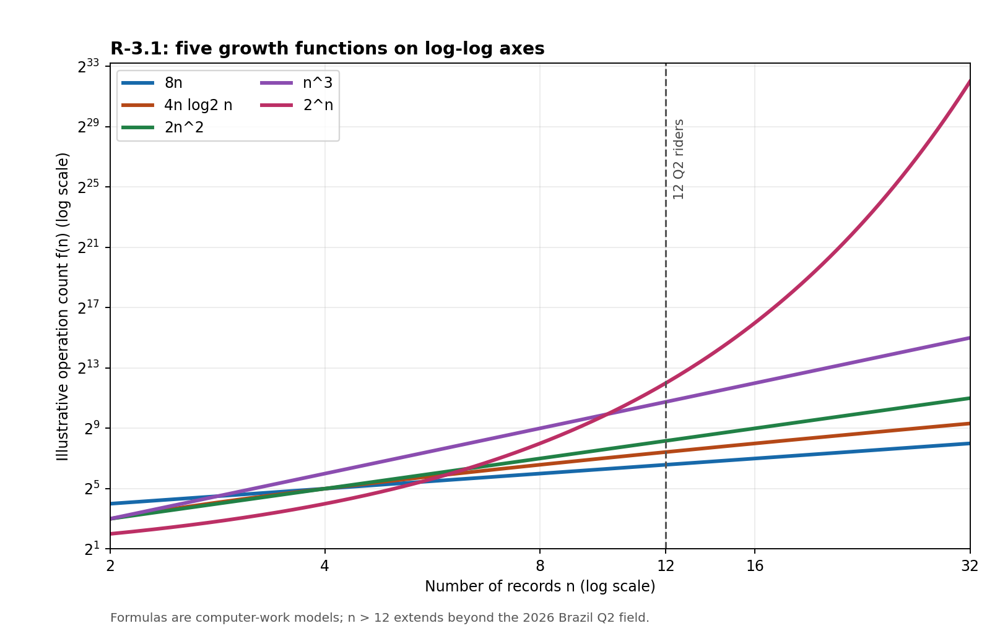

<span id="top"></span>

# Algorithm Analysis — Section 3.5: Exercises

> **Source:** Goodrich, Tamassia, and Goldwasser, _Data Structures and Algorithms in Python_, [Chapter 3](<../../file/Data Structures and Algorithms in Python - C03.pdf>), Section 3.5, printed pages 141–147.  
> **Topic:** Worked Reinforcement, Creativity, and Project exercises on growth rates, proofs, algorithms, and experiments.  
> **Domain focus:** The **2026 Brazilian Grand Prix MotoGP Q2 session** at Goiânia on 21 March 2026.  
> **Learning goal:** Recognize what each of the 58 exercises asks, choose a suitable method, and check the answer on a small example before generalizing.  
> **User Prompt:** "Reexplain [Section 3.5] part by part in more detail, with simple examples, why each example was chosen, and how to solve it, in the format of [01-01-overview.md]. [Use real riders and teams from a specific 2026 MotoGP session, prioritize riders like Marc Marquez and Fabio Quartararo]."

---

## Table of Contents

1. [Background & Conceptual Intuition: Exercises as Proof and Analysis Tasks](#background-intuition)
2. [Part 1: Reinforcement — Plots, Crossovers, and Growth, R-3.1–R-3.8](#part-1)
   - [1. Plot and compare formulas, R-3.1–R-3.5](#part-1-plots)
   - [2. Sum, bound, and rank, R-3.6–R-3.8](#part-1-ranking)
3. [Part 2: Reinforcement — Asymptotic Rules, R-3.9–R-3.22](#part-2)
   - [1. Combine and compare bounds, R-3.9–R-3.15](#part-2-rules)
   - [2. Handle powers, logs, and rounding, R-3.16–R-3.22](#part-2-functions)
4. [Part 3: Reinforcement — Code Costs and Time Budgets, R-3.23–R-3.34](#part-3)
   - [1. Trace Code Fragment 3.10, R-3.23–R-3.27](#part-3-code)
   - [2. Solve budget and composition questions, R-3.28–R-3.32](#part-3-budgets)
   - [3. Explain measured crossovers and records, R-3.33–R-3.34](#part-3-records)
5. [Part 4: Creativity — Algorithms and Counting, C-3.35–C-3.43](#part-4)
   - [1. Sort, select, and challenge a growth label, C-3.35–C-3.37](#part-4-algorithms)
   - [2. Bound sums and change log bases, C-3.38–C-3.40](#part-4-sums)
   - [3. Compare pairs and count capacities, C-3.41–C-3.43](#part-4-counting)
6. [Part 5: Creativity — Harder Proofs and Data Problems, C-3.44–C-3.54](#part-5)
   - [1. Factor, find a missing label, and inspect induction, C-3.44–C-3.47](#part-5-first)
   - [2. Repair a growth proof and evaluate a polynomial, C-3.48–C-3.50](#part-5-fibonacci)
   - [3. Bound logs, encode one outcome, and find a mode, C-3.51–C-3.54](#part-5-last)
7. [Part 6: Projects — Measure Algorithms, P-3.55–P-3.58](#part-6)
   - [1. Plan repeatable benchmarks, P-3.55–P-3.57](#part-6-benchmarks)
   - [2. Measure three uniqueness methods, P-3.58](#part-6-uniqueness)
8. [Part 7: Summary](#part-7)

---

<span id="background-intuition"></span>

## Background & Conceptual Intuition: Exercises as Proof and Analysis Tasks

[Sections 3.1–3.4](03-01-experimental-studies.md) introduced measurement, common growth functions, asymptotic bounds, and proof methods. Section 3.5 puts those tools to work in **58 exercises**: 34 Reinforcement prompts (R-3.1–R-3.34), 20 Creativity prompts (C-3.35–C-3.54), and 4 Projects (P-3.55–P-3.58). This guide paraphrases each task and gives the reasoning and result. The source's original settings—such as meals, lines, and a bottle puzzle—remain where they matter.

The [MotoGP Q2 report](https://www.motogp.com/en/news/2026/03/21/di-giannantonio-heads-bezzecchi-after-dramatic-first-qualifying-in-brazil/1010237) and [published timing classification](https://www.ducati.at/fileadmin/user_upload/page2015/news2026/20260322_MotoGP_Brasilien/2026_MotoGP_Brasilien_Results_Qualifying2.pdf) record 12 riders in **one** 2026 Brazilian GP Qualifying 2 session. The following rows supply the small, real dataset used throughout:

| Q2 place | Rider | Team | Best lap | Milliseconds |
| ---: | :--- | :--- | ---: | ---: |
| P1 | Fabio Di Giannantonio | Pertamina Enduro VR46 Racing Team | 1:17.410 | 77,410 |
| P2 | Marco Bezzecchi | Aprilia Racing | 1:17.480 | 77,480 |
| P3 | Marc Márquez | Ducati Lenovo Team | 1:17.491 | 77,491 |
| P4 | Fabio Quartararo | Monster Energy Yamaha MotoGP Team | 1:17.561 | 77,561 |
| P5 | Jorge Martín | Aprilia Racing | 1:17.630 | 77,630 |
| P6 | Ai Ogura | Trackhouse MotoGP Team | 1:17.702 | 77,702 |
| P11 | Francesco Bagnaia | Ducati Lenovo Team | 1:18.122 | 78,122 |

The integer milliseconds are the published `m:ss.sss` lap times converted to one unit: `1:17.491 = 77,491 ms`. A **lower** best lap is quicker. When code uses `S = [77410, 77480, 77491, 77561]`, it contains the first four riders in official Q2 order; its Python indices are `0,1,2,3`, while their Q2 places are P1–P4.

All larger `n` values, extra target lists, website visits, pairings, and generated benchmark inputs below are **mathematical or programming constructions**. The actual Q2 session had 12 riders. The book's operation counts and microsecond budgets are **computer-work models**, not rider lap times. Unless stated otherwise, `log n` means `log₂ n` and an asymptotic bound uses constants independent of `n`.

| Exercise group | Main question | First move |
| :--- | :--- | :--- |
| **Reinforcement** | What bound, value, crossover, or code cost follows? | Write the formula, simplify it, and count repeated work. |
| **Creativity** | Can we design an algorithm or justify a less obvious claim? | Name the input assumptions and build a proof or invariant. |
| **Projects** | What do measured timings suggest? | Control the input generator, validate outputs, then time repeated trials. |

**Why these examples?** Marc, Fabio, and the other verified Q2 riders make small calculations concrete while keeping the original mathematical tasks intact. **How to solve each exercise:** identify the input-size variable, the requested output, the relevant proof or counting rule, and any assumptions needed for the answer.

[🔝 Back to Top](#top)

---

<span id="part-1"></span>

## Part 1: Reinforcement — Plots, Crossovers, and Growth, R-3.1–R-3.8

<span id="part-1-plots"></span>

### 1. Plot and Compare Formulas, R-3.1–R-3.5

**R-3.1 — Draw five functions on log-log axes.** If the ordinary coordinates are `(n,f(n))`, plot `x = log₂ n` and `y = log₂ f(n)`. For the exercise's functions:

| `f(n)` | Equation in log-log coordinates | Shape |
| :--- | :--- | :--- |
| `8n` | `y = x+3` | Straight, slope 1. |
| `4n log₂ n` | `y = x+2+log₂ x`, for `n>1` | Curved slightly above a slope-1 line. |
| `2n²` | `y = 2x+1` | Straight, slope 2. |
| `n³` | `y = 3x` | Straight, slope 3. |
| `2^n` | `y = 2^x` | Curves sharply upward. |



For a four-record Q2 illustration, `n=4` gives `x=2` and respective model counts `32,32,32,64,16`, so the plotted heights are `5,5,5,6,4`. To draw more of each curve, evaluate `n=2,4,8,16,32,…`; values above 12 describe hypothetical larger lists. Start `4n log₂n` at `n>1` because its value is zero at `n=1`, and `log 0` is undefined.

**R-3.2 — Compare `8n log₂n` with `2n²`.** Divide the strict inequality by positive `2n`:

```text
8n log₂n < 2n²   exactly when   4 log₂n < n.
```

The formulas tie at `n=16`. At `n=17`, `4log₂17≈16.35<17`. The inequality stays true: for every integer `n≥16`, the increase `4log₂(n+1)−4log₂n=4log₂(1+1/n)≤4log₂(17/16)<1`, while `n` increases by `1`. Thus the first method is **strictly better for every integer `n≥17`**; `n₀=17`. These sizes exceed the actual 12-rider Q2 field.

**R-3.3 — Compare `40n²` with `2n³`.** Cancel `2n²>0` to get `20<n`. They tie at `n=20`, and the quadratic formula is smaller for **`n≥21`**.

**R-3.4 — Find a graph unchanged by switching to log-log coordinates.** Use `f(n)=n`. On ordinary axes it is `y=x`; on log-log axes `log₂f(n)=log₂n`, again the diagonal `y=x` in the transformed coordinates.

**R-3.5 — Explain the slope of `n^c`.** Taking logs gives `log(n^c)=c log n`. Thus the plotted equation is `y=cx`, a straight line with slope `c`. For example, a hypothetical comparison of every ordered pair of rider records has `n²` pairs and slope 2.

**Why these examples?** The real four-record field supplies an easy point while the formulas show how plotted shape and crossover depend on growth. **How to solve them:** transform both axes for a plot; for a crossover, compare the **exact** given counts, cancel positive factors, and check where strict inequality begins.

<span id="part-1-ranking"></span>

### 2. Sum, Bound, and Rank, R-3.6–R-3.8

**R-3.6 — Sum the even integers from `0` to `2n`.** Factor out `2` and use the triangular-sum identity:

```text
0+2+4+···+2n = 2(0+1+2+···+n) = n(n+1).
```

At `n=4`, `0+2+4+6+8=20=4(5)`. Here `n` is the number of positive even terms, **not** a Q2 lap time.

**R-3.7 — Relate "always" and worst-case `O(f(n))`.** Let `T(x)` be the time on input `x` and `W(n)` the maximum over inputs of size `n`. If `W(n)≤cf(n)` eventually, then every `T(x)≤W(n)≤cf(n)`. Conversely, if the **same** `c` and threshold work for every input of each size, their maximum also obeys the bound. Constants that change with each input would not establish one worst-case bound.

**R-3.8 — Rank nine functions by eventual growth.** Simplify before ordering; `2^(log₂n)=n`, `2^10` is constant, and the exercise's `4n` is **linear**:

| Growth class, from slow to fast | Expressions in that class |
| :--- | :--- |
| `Θ(1)` | `2^10` |
| `Θ(n)` | `2^(log₂n)`, `3n+100log₂n`, `4n` |
| `Θ(n log n)` | `n log n`, `4n log n+2n` |
| `Θ(n²)` | `n²+10n` |
| `Θ(n³)` | `n³` |
| `Θ(2^n)` | `2^n` |

Ties are genuine **growth-class ties** even when the formulas give different values at a particular `n`. One scan through rider records illustrates linear work; all ordered pairs illustrate quadratic work; all include-or-exclude subsets illustrate `2^n` work.

**Why these examples?** Positions `1–4` make the sum easy to check, and the rider-list tasks give meanings to linear, pair, and subset counts. **How to solve them:** apply the appropriate sum identity or Big-Oh definition, simplify each expression to its dominant term, and compare classes only after that simplification.

[🔝 Back to Top](#top)

---

<span id="part-2"></span>

## Part 2: Reinforcement — Asymptotic Rules, R-3.9–R-3.22

<span id="part-2-rules"></span>

### 1. Combine and Compare Bounds, R-3.9–R-3.15

For these proofs, take eventual bounds `0≤d(n)≤c₁f(n)` and `0≤e(n)≤c₂g(n)`, with positive constants and a common sufficiently large threshold. Think of `d` and `e` as hypothetical costs of two stages of rider-record processing. The **same fixed constants must work at all larger sizes**.

| Exercise | Result and proof move |
| :--- | :--- |
| **R-3.9** | If `d=O(f)` and `a>0` is fixed, then `ad≤(ac₁)f`. Repeating a scan a fixed number of times keeps its class. |
| **R-3.10** | Multiply nonnegative bounds: `de≤c₁c₂fg`, so `de=O(fg)`. Two independent choices, such as an ordered rider pair, multiply their counts. |
| **R-3.11** | Add bounds: `d+e≤c₁f+c₂g≤max(c₁,c₂)(f+g)`. A scan followed by a sort pays for both stages. |
| **R-3.12** | **Subtraction is unsafe.** Let `d=n+1`, `e=1`, `f=n+1`, `g=n`. The premises `d=O(f)` and `e=O(g)` hold, but `d−e=n` is not `O(f−g)=O(1)`. |
| **R-3.13** | Chain `d≤c₁f` and `f≤c₂g` to get `d≤c₁c₂g`. This is transitivity. |
| **R-3.14** | For nonnegative `f,g`, `max(f,g)≤f+g≤2max(f,g)`. Thus `O(max(f,g))=O(f+g)`. |
| **R-3.15** | `f≤cg` is equivalent to `g≥(1/c)f`. Hence `f=O(g)` exactly when `g=Ω(f)`. |

For R-3.12, the two upper bounds do not say how close `d` and `e` are to `f` and `g`. Subtracting their ceilings can leave a tiny comparison function even when the actual difference grows. The counterexample uses positive functions and `f−g=1`, so it does not rely on an undefined `O(0)`.

**Why this example?** A rider scan and sort are familiar stages whose work can be combined, while R-3.12 shows why an apparently similar subtraction rule fails. **How to solve these proofs:** begin with explicit witness inequalities, combine only inequalities that preserve direction, choose a new fixed constant, and state a shared starting size.

<span id="part-2-functions"></span>

### 2. Handle Powers, Logs, and Rounding, R-3.16–R-3.22

| Exercise | How to solve it |
| :--- | :--- |
| **R-3.16** | For a nonconstant polynomial with positive leading coefficient, `p(n)>1` eventually and `p(n)≤Cn^d`. Then `log p(n)≤log C+d log n=O(log n)`. A positive constant polynomial has a bounded logarithm; a polynomial that is negative for large `n` does not fit the real-log statement. |
| **R-3.17** | For `n≥1`, `(n+1)^5≤(2n)^5=32n^5`, so `(n+1)^5=O(n^5)`. |
| **R-3.18** | `2^(n+1)=2·2^n`, so a fixed one-step shift keeps the `O(2^n)` class. |
| **R-3.19** | For `n≥2`, `log₂n≥1`, giving `n≤nlog₂n` and `n=O(nlogn)`. |
| **R-3.20** | `log₂n≤n` gives `n²≥nlog₂n`, so `n²=Ω(nlogn)`. |
| **R-3.21** | For `n≥2`, `nlog₂n≥n`, so `nlogn=Ω(n)`. |
| **R-3.22** | The exercise asks about the **ceiling** `⌈f(n)⌉`. Since `f(n)>1`, `⌈f(n)⌉<f(n)+1≤2f(n)`; therefore `⌈f(n)⌉=O(f(n))`. Nondecreasing `f` is assumed in the prompt but is not needed for this inequality. |

For a Q2-style list, `n` might count rider records while `f(n)` estimates the number of analysis passes. Rounding a positive pass estimate up to a whole pass adds at most one, which explains the R-3.22 bound. These are still **hypothetical computer-work functions**, not race timing data.

**Why these examples?** A one-record increase, a logarithm, and a ceiling each look like they might alter a bound; explicit inequalities show exactly when they do not. **How to solve them:** pick a valid threshold such as `n≥2`, bound the smaller expression by a constant multiple of the comparison function, and preserve the exercise's domain assumptions.

[🔝 Back to Top](#top)

---

<span id="part-3"></span>

## Part 3: Reinforcement — Code Costs and Time Budgets, R-3.23–R-3.34

<span id="part-3-code"></span>

### 1. Trace Code Fragment 3.10, R-3.23–R-3.27

Code Fragment 3.10 supplies five algorithms. Here `S` is the first four Q2 riders' best laps in **integer milliseconds**, in official classification order:

```text
Rider:  Di Giannantonio  Bezzecchi  Marc Márquez  Fabio Quartararo
Index:                 0          1             2                3
S:                77,410     77,480        77,491           77,561
```

Its prefix sums are `77,410`, `154,890`, `232,381`, and `309,942`; adding those prefixes gives `774,623`. The following runnable versions preserve the book's loop structures. `B` is a **synthetic comparison list** of the same length as `S`, not another set of official lap times.

```python
def example1(S):
    total = 0
    for j in range(len(S)):
        total += S[j]
    return total

def example2(S):
    total = 0
    for j in range(0, len(S), 2):
        total += S[j]
    return total

def example3(S):
    total = 0
    for j in range(len(S)):
        for k in range(j + 1):
            total += S[k]
    return total

def example4(S):
    prefix = 0
    total = 0
    for j in range(len(S)):
        prefix += S[j]
        total += prefix
    return total

def example5(A, B):
    if len(A) != len(B):
        raise ValueError("A and B must have equal length")
    count = 0
    for i in range(len(B)):
        total = 0
        for j in range(len(A)):
            for k in range(j + 1):
                total += A[k]
        if B[i] == total:
            count += 1
    return count

S = [77410, 77480, 77491, 77561]  # Q2 P1–P4 best laps in ms.
B = [774623, 77410, 774623, 77561]  # Synthetic target values.
for method in (example1, example2, example3, example4):
    print(method.__name__, method(S))
print("example5", example5(S, B))
```

```text
example1 309942
example2 154901
example3 774623
example4 774623
example5 2
```

| Exercise | What the function returns | Work at `n=4` | General time |
| :--- | :--- | ---: | :--- |
| **R-3.23, `example1`** | Sum all four lap values: `309,942`. | 4 additions | `Θ(n)` |
| **R-3.24, `example2`** | Sum values at **even indices** `0` and `2`: Di Giannantonio plus Marc = `154,901`. | 2 additions | `Θ(n)` |
| **R-3.25, `example3`** | Recompute every prefix sum and add them: `774,623`. | `1+2+3+4=10` additions | `Θ(n²)` |
| **R-3.26, `example4`** | Add each new lap to a running prefix, then add that prefix to the total: `774,623`. | 8 additions | `Θ(n)` |
| **R-3.27, `example5`** | Recompute the **whole** prefix-sum total once per `B[i]`, then count matches: two `774,623` values. | `4·10=40` inner additions | `Θ(n³)` |

For `example5`, the comparison with `B[i]` happens **after** the full nested prefix calculation for each `i`. Moving it into an inner loop would solve a different problem. These addition counts explain the growth; loop-control work adds lower-order or same-order costs. The original questions request **Big-Oh**, so `O(n)`, `O(n²)`, and `O(n³)` are the requested labels; the displayed loops also justify the tighter `Θ` classes here.

**Why this example?** Integer Q2 milliseconds make every output exact and put Marc and Fabio at visible list indices. **How to solve the five exercises:** first determine what is returned, then count loop visits—`n`, about `n/2`, `1+···+n`, `n`, and `n(1+···+n)`—without confusing even **indices** with even values.

<span id="part-3-budgets"></span>

### 2. Solve Budget and Composition Questions, R-3.28–R-3.32

**R-3.28 — Find the largest `n` allowed by a time budget.** If `f(n)` is measured in **microseconds** and the budget is `T` microseconds, solve `f(n)≤T` and round down to a whole input size. For the table below, use `log₂n`, a **30-day month**, and **365-day years**:

| Budget | `T` microseconds |
| :--- | ---: |
| 1 second | 1,000,000 |
| 1 hour | 3,600,000,000 |
| 1 month | 2,592,000,000,000 |
| 1 century | 3,153,600,000,000,000 |

| `f(n)` µs | 1 second | 1 hour | 1 month | 1 century |
| :--- | ---: | ---: | ---: | ---: |
| `log₂n` | `2^1,000,000` | `2^3,600,000,000` | `2^2,592,000,000,000` | `2^3,153,600,000,000,000` |
| `n` | 1,000,000 | 3,600,000,000 | 2,592,000,000,000 | 3,153,600,000,000,000 |
| `n log₂n` | 62,746 | 133,378,058 | 71,870,856,404 | 68,610,956,750,570 |
| `n²` | 1,000 | 60,000 | 1,609,968 | 56,156,922 |
| `2^n` | 19 | 31 | 41 | 51 |

The solution rules are `n≤2^T` for `log₂n`, `n≤T` for `n`, `n≤⌊√T⌋` for `n²`, and `n≤⌊log₂T⌋` for `2^n`. For `nlog₂n`, evaluate the increasing function and use a numerical search for the last integer under `T`. The book's prefilled, extremely large one-second value in the `log n` row is a rough approximation; with base 2, `2^1,000,000≈10^301,030`. These are idealized model budgets, not measurements of a Python program or lap times.

| Exercise | Work to combine | Result |
| :--- | :--- | :--- |
| **R-3.29** | `n` entries, `O(logn)` work for each. | `O(nlogn)` worst case. |
| **R-3.30** | About `log n` randomly chosen entries, `O(n)` work for each. | `O(nlogn)` worst case; random selection does not change the stated per-choice bound. |
| **R-3.31** | All odd values use `n·O(logn)`; all even values use `n·O(n)`. | Best-case **upper bound** `O(nlogn)`; worst-case upper bound `O(n²)`. Matching `Θ` claims need matching lower-cost assumptions. |
| **R-3.32** | Entry `S[i]` costs `O(i)`, so total work is bounded by `Σ_(i=0)^(n−1)i=n(n−1)/2`. | `O(n²)` worst case. |

The first four Q2 lap-millisecond values contain even numbers (`77,410` and `77,480`) and odd numbers (`77,491` and `77,561`), so they can illustrate R-3.31's branches. The best- and worst-case asymptotic cases are **hypothetical input families**, not statements about this fixed four-rider sample.

**Why these examples?** A budget converts abstract growth into a maximum record count, while the mixed parity of the real lap integers makes R-3.31's two branches concrete. **How to solve them:** convert units first, invert the time formula, round down, and add or multiply repeated per-entry work with the correct loop count.

<span id="part-3-records"></span>

### 3. Explain Measured Crossovers and Records, R-3.33–R-3.34

**R-3.33 — Why can the quadratic method win below 100?** Asymptotic labels do not fix constant multipliers or setup costs. A method with `Θ(nlogn)` growth can be slower at small `n` if its fixed factor is large. The book's observation—quadratic faster for `n<100`, linear-log faster for `n≥100` in its experiment—is therefore possible. For a Q2-style example, compare the illustrative models `400n` and `2n²` from Section 3.3: at the real `n=12`, they give `4,800` and `288` model microseconds, while their order reverses after `n=200`. Compare actual implementations on the **same task and inputs**; a loose Big-Oh upper bound alone does not determine a crossover.

**R-3.34 — Expected "best so far" meals.** Under a uniformly random order of `n` distinct meal qualities, the `j`th meal is a new best with probability `1/j`. Add those probabilities to get the expected happy occasions:

```text
E[records] = 1 + 1/2 + ··· + 1/n = H_n = Θ(log n).
```

For the four distinct Q2 best-lap values, imagine **shuffling their order** and recording each new **fastest** lap. The actual published fastest-to-slowest order gives one record; the reverse order gives four. Across all uniformly random orders, the expected record count is `H₄=25/12≈2.083`. This is an analogy for the book's meal story, **not** a claim about the riders' actual qualifying attempts. A scan still reads all `n` values even when the number of record updates is logarithmic on average.

**Why these examples?** Q2's small field exposes the effect of constants and gives four distinct values for a record process. **How to solve them:** compare complete cost formulas for finite crossovers; for expected records, assign probability `1/j` to each position and use linearity of expectation.

[🔝 Back to Top](#top)

---

<span id="part-4"></span>

## Part 4: Creativity — Algorithms and Counting, C-3.35–C-3.43

<span id="part-4-algorithms"></span>

### 1. Sort, Select, and Challenge a Growth Label, C-3.35–C-3.37

**C-3.35 — Improve three-way set disjointness to `O(nlogn)`.** The task asks whether any value occurs in all three size-`n` sets. Sort each set, then keep one pointer in each sorted list. If all three current values agree, a common member exists. Otherwise advance the pointer at the **smallest** current value: because the other current values, and all values after them, are larger, that smallest value cannot be a three-way match. The scan moves a pointer at most `3n` times, so it is `O(n)` after `O(nlogn)` sorting.

For a small Q2 illustration, let analyst shortlists be `A={Marc Márquez, Fabio Quartararo, Jorge Martín}`, `B={Fabio Quartararo, Marco Bezzecchi, Ai Ogura}`, and `C={Marc Márquez, Ai Ogura, Fabio Di Giannantonio}`. The lists are **constructed from real Q2 riders**. A and B share Fabio, A and C share Marc, and B and C share Ai, yet none belongs to all three. Sorting plus the pointer walk correctly reports no three-way common name.

**C-3.36 — Find the ten largest values in `O(n)` time.** Keep a sorted buffer of at most ten largest values seen so far. For each new value, insert it if the buffer has room or if it exceeds the current smallest; then discard that smallest if the buffer grows past ten. Since ten is fixed, each update takes at most a constant number of comparisons and shifts, so the total is `O(n)` time and `O(1)` extra space relative to `n`. If `n<10`, return all `n` values. As a two-value warmup on the first four Q2 best laps, the **largest times** are Fabio's `77,561 ms` and Marc's `77,491 ms`; larger lap time means **slower**, not faster.

**C-3.37 — Find a positive function that is neither `O(n)` nor `Ω(n)`.** Use the mathematical construction:

```text
f(n) = n² when n is even;   f(n) = 1 when n is odd.
```

On even `n`, `f(n)/n=n` grows without bound, ruling out `O(n)`. On odd `n`, `f(n)/n=1/n` tends to zero, ruling out `Ω(n)`. This deliberately oscillating function is **not** a measured Q2 program.

**Why these examples?** The Q2 shortlists make "common to all three" stricter than pairwise overlap, and the lap-time warmup makes "largest" precise. **How to solve them:** for three sets, sort and advance the least current value; for a fixed top ten, maintain only ten candidates; for a counterexample to two bounds, examine two infinite subsequences.

<span id="part-4-sums"></span>

### 2. Bound Sums and Change Log Bases, C-3.38–C-3.40

**C-3.38 — Bound `Σ_(i=1)^n i²`.** Every term `i²` is at most `n²`, and there are `n` terms. Thus `Σi²≤n·n²=n³`, proving `O(n³)`. The first four Q2 place numbers supply a check: `1²+2²+3²+4²=30≤4³=64`. The place numbers are labels, not measured computational costs.

**C-3.39 — Show `Σ_(i=1)^n i/2^i<2`.** Halve the sum, align its shifted terms with the original, and subtract. The finite-sum identity is:

```text
Σ_(i=1)^n i/2^i = 2 − (n+2)/2^n < 2.
```

The last fraction is positive for every finite positive `n`. At `n=4`, the terms `1/2+2/4+3/8+4/16` total `13/8=1.625`. The infinite sum approaches `2`, but no finite prefix equals it.

**C-3.40 — Change the logarithm base.** For fixed `b>1` and `f(n)>1` eventually,

```text
log_b f(n) = log₂ f(n) / log₂ b.
```

The denominator is one positive constant, so `log_b f(n)=Θ(log f(n))`. Changing from binary to decimal levels in an analysis changes a multiplier, not its asymptotic class.

**Why these examples?** Small Q2 place numbers let us check the first few terms without mistaking those checks for the proof. **How to solve them:** upper-bound each square, shift and subtract the geometric-style sum, and use the change-of-base identity for logarithms.

<span id="part-4-counting"></span>

### 3. Compare Pairs and Count Capacities, C-3.41–C-3.43

**C-3.41 — Find both minimum and maximum with fewer than `3n/2` comparisons.** Split values into pairs. One comparison per pair sends the smaller member to a minimum-candidate group and the larger to a maximum-candidate group. Find the minimum among the former and maximum among the latter. For even `n`, the exact comparison count is:

```text
n/2 pair checks + (n/2−1) minimum checks + (n/2−1) maximum checks
= 3n/2−2 < 3n/2.
```

For odd `n`, initialize both extrema from one unpaired value and process each of the remaining `(n−1)/2` pairs with three comparisons, for `3(n−1)/2<3n/2`. On the first four Q2 lap times, pair Di Giannantonio with Bezzecchi and Marc with Fabio. Two pair checks, one candidate-minimum check, and one candidate-maximum check return `77,410 ms` (Di Giannantonio) and `77,561 ms` (Fabio) in **four comparisons**. The minimum is the quickest best lap among these four.

**C-3.42 — Find the website-visit threshold.** In the book's story, person `i` may visit at most `i` times. If **nobody** has reached their individual cap, person `i` has made at most `i−1` visits. The total can then be at most:

```text
Σ_(i=1)^n(i−1) = 0+1+···+(n−1) = n(n−1)/2.
```

One more visit forces someone to have reached a cap, so the smallest guaranteed threshold is **`n(n−1)/2+1`**. If the 12 Q2 places were merely used as **hypothetical person labels**, the threshold would be `12·11/2+1=67` visits. No Q2 rider website activity is asserted.

**C-3.43 — Draw the odd-`n` version of the staircase proof.** For `n=2k+1`, pair the first and last heights, then the second and next-to-last, and so on. There are `k` pairs, each summing to `n+1`, plus one middle height `k+1=(n+1)/2`:

```text
First five Q2 place numbers:  1   2   3   4   5
Outer pair:                   1 + 5 = 6
Inner pair:                   2 + 4 = 6
Unpaired middle:                  3
Total:                       6 + 6 + 3 = 15 = 5·6/2.
```

In general, `k(n+1)+(n+1)/2=n(n+1)/2`. The Q2 positions are a picture for the arithmetic, not heights of actual track objects.

**Why these examples?** Pairing four real lap values makes the saved comparisons countable; the first five official places make the odd middle term visible. **How to solve them:** partition min/max candidates, compute the largest total that avoids a cap, and account for the unmatched center in an odd staircase.

[🔝 Back to Top](#top)

---

<span id="part-5"></span>

## Part 5: Creativity — Harder Proofs and Data Problems, C-3.44–C-3.54

<span id="part-5-first"></span>

### 1. Factor, Find a Missing Label, and Inspect Induction, C-3.44–C-3.47

**C-3.44 — Analyze the book's trial-division algorithm.** The source imagines an integer `r=pq` formed from primes `p<q` and tests possible divisors in increasing order. This is a **simplified classroom model**, not a modern encryption procedure. Since `p<√r`, the first successful trial occurs before `√r` even though the written loop's upper limit is `r`.

- **Part (a):** A 100-bit `r` can have `p` close to `2^50`. Nearly `2^50≈1.126·10^15` trial divisions at **1 microsecond each** take about `1.126·10^9` seconds, or **35.7 years** using 365-day years.
- **Part (b):** The exercise defines input length `n≈(log₂r)/8+1` bytes and charges `O(n)` for each division. Since `√r=2^((log₂r)/2)=O(2^(4n))`, the promised two-prime input gives **`O(n·2^(4n))`** time. If one ignored the promise and analyzed the literal loop on an arbitrary large prime `r`, the weaker upper bound would be `O(n·2^(8n))`.

The Q2 lap data are not cryptographic inputs; keeping this exercise in its own setting avoids confusing milliseconds with arithmetic bit lengths.

**C-3.45 — Find the missing integer in `O(n)` time and `O(1)` extra space.** For `n−1` distinct values drawn from `0,1,…,n−1`, the expected complete sum is `n(n−1)/2`. Subtract the observed sum in one pass. As a **constructed** Q2 check, convert the 12 official places P1–P12 to labels `0–11` by subtracting one, then imagine omitting Marc's P3 label `2`:

```text
Expected complete sum = 0+1+···+11 = 12·11/2 = 66.
Observed sum after the hypothetical omission = 64.
Missing label = 66−64 = 2, corresponding to P3, Marc Márquez.
```

Marc was **not actually missing** from Q2. The algorithm uses a few running integer variables and one scan. As usual in the chapter, a machine word holding these sums is treated as constant-cost storage.

**C-3.46 — Find the flaw in the "all sheep have one color" induction.** The proposed induction removes two different sheep in turn and assumes the resulting size-`n−1` groups overlap, so their colors can be linked. At the first step, `n=2`, each group contains only one **different** sheep: there is no shared member. The same faulty argument would claim that Marc and Fabio ride for the same team because each one-rider group has one team; their **different** Q2 teams expose the error. An induction step must really connect the base case to the next size.

**C-3.47 — Count intersections of general-position lines.** Assume no two of `n` lines are parallel and no three cross at one point. Each new line meets all `n−1` earlier lines at **different new points**, so `I(n)=I(n−1)+(n−1)` with `I(1)=0`. Therefore:

```text
I(n) = 1+2+···+(n−1) = n(n−1)/2 = Θ(n²).
```

If four **abstract** lines were labeled with the first four Q2 riders, they would make `4·3/2=6` intersections under these assumptions. These are geometric lines, not riders' track paths.

**Why these examples?** The original factoring and sheep settings expose assumptions that a forced racing analogy would hide. Marc's rank makes the missing-label arithmetic easy to check, and the labeled lines give a small intersection count. **How to solve them:** retain the source's input promise, identify the invariant total or missing overlap, and use the exact assumptions needed for each count.

<span id="part-5-fibonacci"></span>

### 2. Repair a Growth Proof and Evaluate a Polynomial, C-3.48–C-3.50

**C-3.48 — Diagnose the false proof that `F(n)=O(n)`.** The book's shifted Fibonacci values satisfy `F(1)=1`, `F(2)=2`, and `F(n)=F(n−1)+F(n−2)`. The tempting proof says both smaller values are individually `O(n)`, so their sum is `O(n)`. But a Big-Oh claim requires **one constant `c` that works for all sufficiently large `n`**. Even if the induction assumption gave `F(k)≤ck` for every smaller `k`, it would yield only:

```text
F(n) ≤ c(n−1)+c(n−2) = c(2n−3),
```

which does not re-establish `F(n)≤cn` with that same `c`. Letting the hidden constant increase at every step is not a valid induction. The next exercise proves an exponential lower bound, confirming that a linear upper bound is false.

**C-3.49 — Prove `F(n)=Ω((3/2)^n)` by induction.** Choose a fixed `c=2/3`. The two required bases hold: `F(1)=1=c(3/2)` and `F(2)=2≥c(3/2)^2=3/2`. If the bound holds for both smaller indices, then:

```text
F(n) = F(n−1)+F(n−2)
     ≥ c(3/2)^(n−1)+c(3/2)^(n−2)
     = c(3/2)^(n−2)(5/2)
     ≥ c(3/2)^(n−2)(9/4)
     = c(3/2)^n.
```

The constant is independent of `n`, so the induction supplies the missing uniform witness. As in Section 3.4, a hypothetical grouping of successive Q2 riders can picture the recurrence for at most the real 12-rider field; the all-`n` result is mathematical.

**C-3.50 — Evaluate a degree-`n` polynomial three ways.** The exercise's `p(x)=Σ_(i=0)^n a_i x^i` has `n+1` coefficients. For a small **synthetic calculation**, take the first four Q2 lap-millisecond values as coefficients `[a₀,a₁,a₂,a₃]=[77410,77480,77491,77561]` and set dimensionless `x=2`:

```text
p(2) = 77410 + 77480·2 + 77491·4 + 77561·8
     = 1,162,822.
```

This number is a polynomial example, **not** a lap result. The three methods differ in how they form the powers:

| Method | Work for degree `n` | Reason |
| :--- | :--- | :--- |
| **(a) Recompute every `x^i` from scratch** | `O(n²)` | Power `i` takes `i` multiplications; `Σ_(i=1)^n i=Θ(n²)`. |
| **(b) Compute each `x^i` by repeated squaring** | `O(nlogn)` | Each power takes `O(log i)` operations; add over `i=1,…,n`. |
| **(c) Horner's nested form** | `O(n)` | Process coefficients from `a_n` down to `a₀` with one multiply and one add per step. |

For the four coefficients, Horner's calculation is `((77561·2+77491)·2+77480)·2+77410=1,162,822`. It avoids materializing any separate power of `x`.

**Why these examples?** Marc and Fabio's lap integers provide exact coefficients; the bad Fibonacci proof shows why asymptotic constants must remain fixed. **How to solve them:** inspect what the induction actually preserves, prove both Fibonacci bases, and count how many multiplications each polynomial strategy performs.

<span id="part-5-last"></span>

### 3. Bound Logs, Encode One Outcome, and Find a Mode, C-3.51–C-3.54

**C-3.51 — Upper-bound `Σ_(i=1)^n log₂i`.** Since `log₂i≤log₂n` for every `1≤i≤n`, the `n` terms sum to at most `nlog₂n`. Hence the sum is `O(nlogn)`.

**C-3.52 — Prove the matching lower bound.** At least `n/2` indices lie in the upper half `i≥n/2`. For `n≥4`, each of those terms is at least `log₂(n/2)≥(1/2)log₂n`. Thus:

```text
Σ_(i=1)^n log₂i ≥ (n/2)·(1/2)log₂n
                 = (n/4)log₂n = Ω(nlogn).
```

Together, C-3.51 and C-3.52 show `Σlog₂i=Θ(nlogn)`. At the four-rider illustration, the terms are `0,1,log₂3,2`; checking four values helps intuition, while the inequalities prove all sizes.

**C-3.53 — Identify one marked bottle in one round with `O(logn)` testers.** This is the book's **thought experiment**, not a practical testing procedure. Give each of `n` bottles a unique `k`-bit label where `k=⌈log₂n⌉`. Tester `j` is assigned the bottles whose label has bit `j=1`. Run all `k` tests in parallel; after the one-month observation, their binary outcome pattern identifies the one marked bottle. Exactly one bottle is known to be marked, so an all-zero pattern can represent the bottle labeled zero. As a harmless encoding check, the 12 Q2 place labels could be distinguished by `⌈log₂12⌉=4` binary questions; no rider or real bottle is being tested.

**C-3.54 — Find a most frequent value in `[0,4n]`.** Make an array of `4n+1` zero counters, scan the `n` input integers and increment the matching counters, then scan the counters for a maximum. Both passes are `O(n)`; the extra array is `O(n)` space. Ties may return any maximizer unless a tie rule is added. For a **synthetic team encoding** of five selected Q2 records, use `0` for Ducati Lenovo, `1` for Monster Energy Yamaha, `2` for Aprilia Racing, and `3` for Pertamina VR46. In selected Q2 order `[P1,P2,P3,P4,P11]`, the codes are `[3,2,0,1,0]`; code `0` occurs twice, reflecting Marc and Bagnaia's real shared team. These codes are teaching labels in the allowed range `0–20`, not published timing data.

**Why these examples?** The log-sum proofs use an easy upper and lower sandwich, while the Q2 labels make binary encoding and a repeated value tangible. **How to solve them:** bound all terms above, bound a large fraction of terms below, use enough bits for `n` distinct outcomes, and exploit the known small integer range with counters.

[🔝 Back to Top](#top)

---

<span id="part-6"></span>

## Part 6: Projects — Measure Algorithms, P-3.55–P-3.58

The four projects ask for **experimental evidence**, so they need input families that grow beyond the fixed 12-rider Q2 classification. A reproducible teaching generator can cycle through `[77410,77480,77491,77561]` to build longer **synthetic** lists. Such repeated values are invented benchmark input, not additional real laps or riders. For every comparison, validate results first, use the same input at each size, repeat timings, and report the machine and input rule. Finite measurements can support a growth hypothesis; the proofs of Section 3.3 explain the all-`n` bounds.

<span id="part-6-benchmarks"></span>

### 1. Plan Repeatable Benchmarks, P-3.55–P-3.57

**P-3.55 — Compare the three prefix-average algorithms.** Use `prefix_averages1`, `prefix_averages2`, and `prefix_averages3` from [Section 3.3](03-03-asymptotic-analysis.md). For each size, pass an identical synthetic list to all three, verify that the averages agree, then record repeated timings. Plot **input size `n`** against **elapsed seconds** with logarithmic scales on both axes. The first two reprocess prefixes and should show roughly slope 2; the running-total third should show roughly slope 1 over a range where timer noise is small.

**P-3.56 — Compare Code Fragment 3.10.** The five runnable functions in Part 3 can be timed with growing `S` lists. Give `example5` a second, equal-length, **synthetic** `B` list. Use smaller sizes for its cubic work so the experiment completes. The expected log-log slopes are approximately `1,1,2,1,3` for `example1` through `example5`. They compute **different outputs**; check each against its own expected result rather than requiring all five answers to match.

**P-3.57 — Test the average sorting hypothesis.** For each `n`, generate many independently shuffled lists of distinct integers, time `sorted(S)`, and report a median or mean with the sampling rule. Examine `time/(nlog₂n)` as well as a log-log chart. A roughly stable ratio is consistent with `O(nlogn)` behavior on those inputs. Already sorted or nearly sorted inputs may follow a different practical pattern, so they should be labeled as a different distribution.

A small timing helper makes the measurement step explicit:

```python
from statistics import median
from time import perf_counter_ns

def median_seconds(action, repeats=7):
    samples = []
    for _ in range(repeats):
        start = perf_counter_ns()
        action()
        samples.append((perf_counter_ns() - start) / 1_000_000_000)
    return median(samples)

# Part 3 defines example4 and S; this is a small functionality check,
# not evidence of asymptotic growth or a published MotoGP timing.
assert example4(S) == 774623
sample_seconds = median_seconds(lambda: example4(S))
assert sample_seconds >= 0
```

For a log-log chart, plot only **positive** elapsed times, label the axes and units, and use multiple sizes large enough that the timer measures more than overhead. Reuse the same generated input for methods being directly compared. For sorting, generate fresh random permutations across trials to give "average" an explicit distribution.

**Why these examples?** The four real lap values give a traceable seed, while synthetic extensions provide the varying `n` that an asymptotic experiment requires. **How to solve the projects:** define the generator, verify outputs, collect repeated times per size, plot log-log values, and compare the observed curve with the predicted loop counts without treating finite data as a proof.

<span id="part-6-uniqueness"></span>

### 2. Measure Three Uniqueness Methods, P-3.58

**P-3.58 — Find the largest input each uniqueness method handles within one minute on the test machine.** `unique1` checks pairs; `unique2` sorts and checks neighbors. Both are covered in [Section 3.3](03-03-asymptotic-analysis.md). The project's `unique3` is **not defined in the supplied Chapter 3 PDF**; it appears later as the recursive method of Chapter 4, explained in [Section 4.3](../04-recursion/04-03-recursion-run-amok.md). Its no-duplicate path branches twice at each size and has exponential work.

Use the **corrected** `unique2` from Section 3.3: the chapter's Code Fragment 3.8 sorts a copy but mistakenly compares neighbors in the original sequence. The simple regression `[1,2,1]` must return `False`; comparing the sorted copy detects the separated duplicate. For all three methods, test both duplicate and all-distinct cases before timing.

To measure a one-minute limit, use independently shuffled **all-distinct synthetic labels** at each size; an early duplicate can make a method finish far sooner. Try increasing sizes until a method exceeds the limit, then narrow the interval and repeat measurements near the boundary. Use **different size ranges** for the quadratic, sort-based, and recursive methods. Record the largest tested `n` that actually completed in at most 60 seconds, the machine, Python version, generator, number of trials, and timing spread. There is **no machine-independent numerical answer** to this experimental question.

The real Q2 team list is a useful correctness check because Marc and Bagnaia share Ducati Lenovo Team, but it has a duplicate and only 12 records. It is **not** the all-distinct growing family needed to expose each method's slow path.

**Why this example?** Marc and Bagnaia give a genuine duplicate, and the Chapter 4 link resolves the exercise's forward reference to `unique3`. **How to solve it:** specify the exact three implementations, fix the sorted-copy bug, verify correctness, then search for each machine-specific time threshold on comparable all-distinct inputs.

[🔝 Back to Top](#top)

---

<span id="part-7"></span>

## Part 7: Summary

| Exercise range | Main technique | Q2-based check or important assumption |
| :--- | :--- | :--- |
| **R-3.1–R-3.8** | Transform plots, solve exact crossovers, simplify growth. | Four Q2 records give a small point; larger `n` is hypothetical. |
| **R-3.9–R-3.22** | Prove asymptotic rules with fixed witnesses. | Work counts can be added or multiplied; upper bounds cannot simply be subtracted. |
| **R-3.23–R-3.34** | Trace nested loops, invert budgets, count expected records. | Four official best laps yield exact integer-millisecond outputs. |
| **C-3.35–C-3.43** | Sort, keep fixed-size candidates, pair comparisons, and count. | Marc and Fabio appear in shortlists and min/max examples. |
| **C-3.44–C-3.54** | Preserve input promises, repair induction, improve algorithms. | Marc's P3 label and the shared Ducati Lenovo team provide checks. |
| **P-3.55–P-3.58** | Design fair, reproducible timing studies. | Extend the real seed data **synthetically**; report observed times separately from proved bounds. |

**Section 3.5's path:** read the exact task and notation → identify the relevant mathematical rule or algorithm → solve a small check → justify the result for the allowed inputs → measure only where the exercise asks for evidence.

[🔝 Back to Top](#top)
