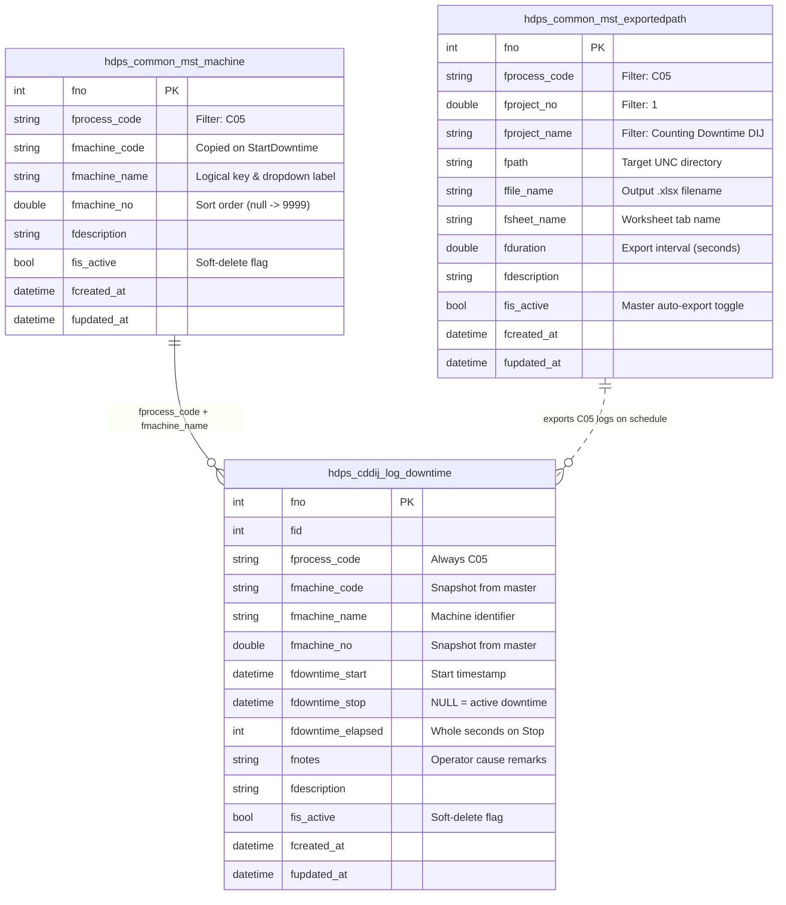

# HDP Counting Downtime DIJ — Database Schema

All database operations for **HDP Counting Downtime DIJ** run through a single Entity Framework 6 Database-First context: **`HDPStudioEntities`**. The module interacts with **3 tables** partitioned cleanly by `fprocess_code = "C05"` (Digital Inkjet / DIJ).

---

## 1. Entity Relationship Diagram

Tables are joined logically at the application layer by `fprocess_code` (`"C05"`) and `fmachine_name` rather than strict SQL foreign-key constraints, allowing flexible master-data administration and soft deletes (`fis_active`).



---

## 2. Table Definitions (`HDPStudioEntities`)

### `hdps_common_mst_machine` (Master Machine Registry)

Source model: `Models/hdps_common_mst_machine.cs`. Shared across HDP Studio modules; Counting Downtime DIJ filters rows where `fprocess_code == "C05"` and `fis_active == true`.

| Column | CLR Type | Nullable | Role in Counting Downtime DIJ |
| :--- | :--- | :---: | :--- |
| `fno` | `int` | No (PK) | Primary key |
| `fprocess_code` | `string` | Yes | Process partition filter (`"C05"` for DIJ) |
| `fmachine_code` | `string` | Yes | Machine group/asset code; copied into `hdps_cddij_log_downtime` on `StartDowntime` |
| `fmachine_name` | `string` | Yes | Display name shown in `#selectMachine`, URL deep links, and history badge (must be non-whitespace) |
| `fmachine_no` | `double?` | Yes | Numeric display sort order (`OrderBy(x => x.fmachine_no ?? 9999).ThenBy(x => x.fmachine_name)`) |
| `fdescription` | `string` | Yes | Optional descriptive text |
| `fis_active` | `bool?` | Yes | Must be `true` (`1`) to appear in dropdown and machine lookups |
| `fcreated_at`, `fupdated_at`, `fdeleted_at`, `frestored_at` | `DateTime?` | Yes | Standard HDP Studio audit timestamps |
| `fcreated_by`, `fupdated_by`, `fdeleted_by`, `frestored_by` | `string` | Yes | Standard HDP Studio audit user fields |

---

### `hdps_cddij_log_downtime` (Transactional Downtime Log)

Source model: `Models/hdps_cddij_log_downtime.cs`. Core transactional table storing both live ongoing stoppages (`fdowntime_stop IS NULL`) and completed downtime history.

| Column | CLR Type | Nullable | Role in Counting Downtime DIJ |
| :--- | :--- | :---: | :--- |
| `fno` | `int` | No (PK) | Auto-increment primary key returned as `fno` to the client (`_activeFno`) |
| `fid` | `int?` | Yes | Optional secondary ID (not populated by controller) |
| `fis_active` | `bool?` | Yes | Set to `true` on insert; all status queries and Excel exports filter `fis_active == true` |
| `fdescription` | `string` | Yes | Optional general description (not populated by controller) |
| `fprocess_code` | `string` | Yes | Always written as `"C05"` |
| `fmachine_code` | `string` | Yes | Snapshot copied from `hdps_common_mst_machine.fmachine_code` at Start time |
| `fmachine_name` | `string` | Yes | Trimmed machine name |
| `fmachine_no` | `double?` | Yes | Snapshot copied from `hdps_common_mst_machine.fmachine_no` at Start time |
| `fdowntime_start` | `DateTime?` | Yes | Server local timestamp (`DateTime.Now`) when **Start** was clicked |
| `fdowntime_stop` | `DateTime?` | Yes | `NULL` while downtime is actively running; set to `DateTime.Now` when **Stop** is clicked |
| `fdowntime_elapsed` | `int?` | Yes | `NULL` while running; integer whole seconds `(int)Math.Max(0, (stop - start).TotalSeconds)` computed on Stop |
| `fnotes` | `string` | Yes | Trimmed operator cause notes (nullable); editable at Start, during downtime, at Stop, or post-Stop via `SubmitNotes` |
| `fcreated_at` | `DateTime?` | Yes | Set to `DateTime.Now` on `StartDowntime` |
| `fupdated_at` | `DateTime?` | Yes | Set to `DateTime.Now` on `StopDowntime` and `SubmitNotes` |
| `fcreated_by`, `fupdated_by` | `string` | Yes | Explicitly written as `null` (shopfloor auth-bypass mode) |
| `fdeleted_at`, `frestored_at`, `fdeleted_by`, `frestored_by` | `DateTime?` / `string` | Yes | Standard HDP Studio soft-delete audit columns |

---

### `hdps_common_mst_exportedpath` (Scheduled Auto-Export Config)

Source model: `Models/hdps_common_mst_exportedpath.cs`. Shared configuration table governing automated network exports across HDP Studio modules.

| Column | CLR Type | Nullable | Role in Counting Downtime DIJ |
| :--- | :--- | :---: | :--- |
| `fno` | `int` | No (PK) | Primary key |
| `fprocess_code` | `string` | Yes | Matched against `"C05"` |
| `fproject_no` | `double?` | Yes | Matched against `1` |
| `fproject_name` | `string` | Yes | Matched against `"Counting Downtime DIJ"` |
| `fmachine_code`, `fmachine_name`, `fmachine_no` | `string` / `double?` | Yes | Generic schema columns (not filtered by this module's exporter) |
| `fpath` | `string` | Yes | Target UNC output folder; falls back to `\\<file-server>\Public\HDP\HDP Studio\Exported` if blank |
| `ffile_name` | `string` | Yes | Output `.xlsx` filename; falls back to `"Counting Downtime DIJ.xlsx"` if blank |
| `fsheet_name` | `string` | Yes | Excel worksheet name; falls back to `"Sheet1"` if blank |
| `fduration` | `double?` | Yes | Recurring export interval in **seconds** (e.g., `300` = 5 minutes); re-applied live on every tick |
| `fdescription` | `string` | Yes | Optional administrative notes |
| `fis_active` | `bool?` | Yes | Master kill switch — setting to `0` (`false`) or `NULL` disables scheduled exports immediately |
| `fcreated_at`, `fupdated_at`, `fdeleted_at`, `frestored_at` | `DateTime?` | Yes | Standard HDP Studio audit timestamps |
| `fcreated_by`, `fupdated_by`, `fdeleted_by`, `frestored_by` | `string` | Yes | Standard HDP Studio audit user fields |

---

## 3. Core Data Invariants & Diagnostic Queries

### Active Downtime Invariant
A machine is considered **actively down** if and only if at least one row exists matching:

```sql
SELECT fno, fmachine_name, fdowntime_start, fnotes
FROM hdps_cddij_log_downtime
WHERE fprocess_code = 'C05'
  AND fis_active = 1
  AND fdowntime_stop IS NULL
ORDER BY fdowntime_start DESC;
```

- `StartDowntime` enforces at most **one** open row per `(fprocess_code = 'C05', fmachine_name)`.
- `GetMachineStatus` returns the newest open row (if any) as `active`, plus the latest **5** rows (`TOP 5 ORDER BY fdowntime_start DESC`) for the history table.

### Checking Active Export Configuration

```sql
SELECT fno, fprocess_code, fproject_no, fproject_name,
       fpath, ffile_name, fsheet_name, fduration, fis_active
FROM hdps_common_mst_exportedpath
WHERE fprocess_code = 'C05'
  AND fproject_name = 'Counting Downtime DIJ'
  AND fproject_no = 1;
```

---

## Next Step

Learn day-to-day shopfloor procedures, per-machine PWA installation, SQL export tuning, and troubleshooting in the [Operator & Supervisor Guide](./user-guide.md).
