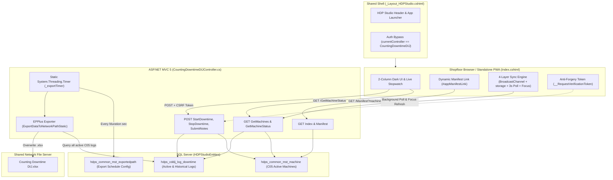
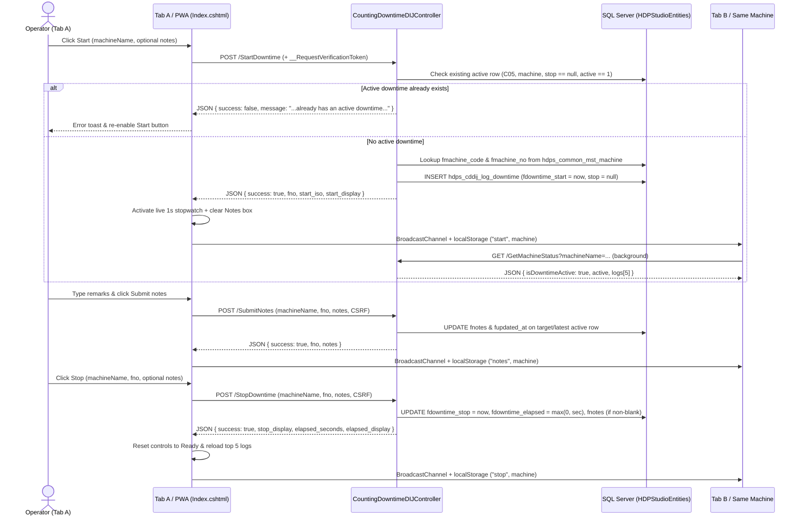
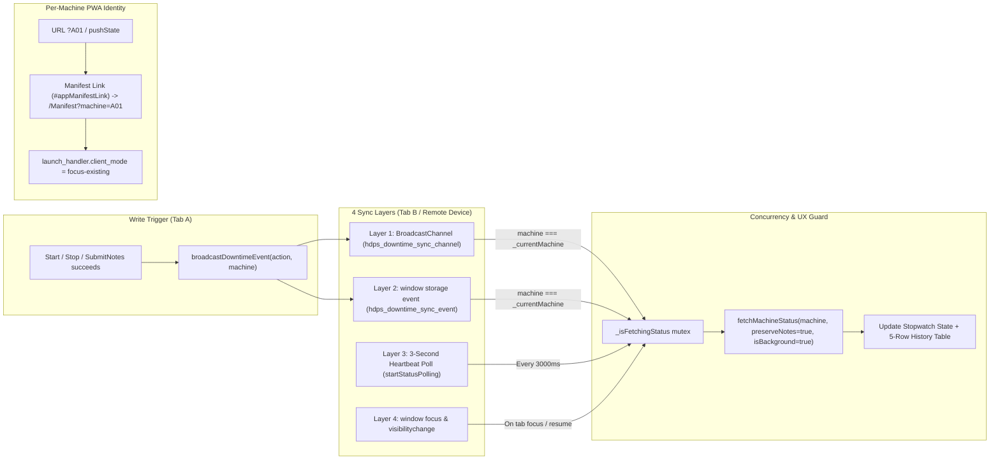
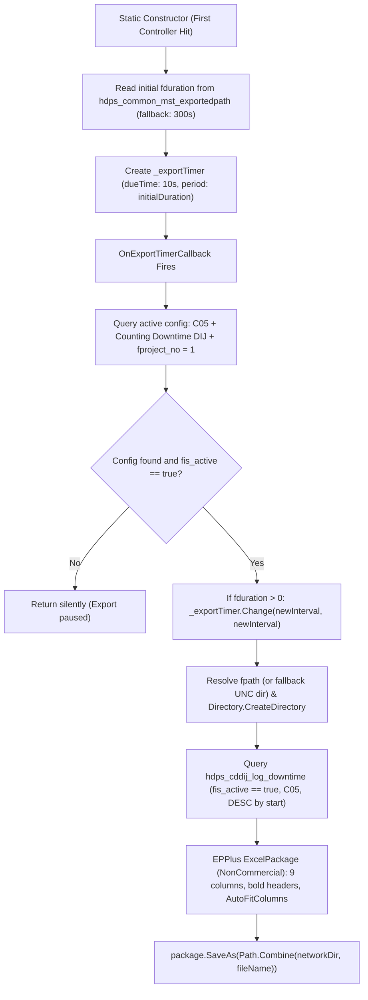

# HDP Counting Downtime DIJ — System Architecture

**HDP Counting Downtime DIJ** follows a compact, single-context ASP.NET MVC 5 architecture paired with an autonomous client-side state/sync engine and a static in-process Excel export scheduler. Unlike larger multi-context dashboards such as HDP OEE Neo Spray, all persistence flows through a single Entity Framework 6 context (`HDPStudioEntities`).

---

## 1. High-Level Component Architecture

### Architectural Layer Responsibilities

| Layer | Responsibility | Key Files / Symbols |
| :--- | :--- | :--- |
| **Shell & Access** | Renders HDP Studio navigation, skips session login gate for kiosk readiness | `Views/Shared/_Layout_HDPStudio.cshtml` |
| **Presentation & Sync** | Renders machine selector, live `HH:MM:SS` timer, 5-row history table, dynamic PWA manifest, and multi-window sync | `Views/CountingDowntimeDIJ/Index.cshtml` |
| **Controller API** | Serves views/manifests, enforces single-active-downtime rule, validates CSRF tokens, computes elapsed seconds | `Controllers/CountingDowntimeDIJController.cs` |
| **Scheduled Reporting** | Static background timer that polls SQL export config and regenerates a 9-column `.xlsx` workbook via EPPlus | `_exportTimer`, `OnExportTimerCallback`, `ExportDataToNetworkPathStatic` |
| **Database (`HDPStudioEntities`)** | Stores master `C05` machines, transactional downtime logs, and dynamic export parameters | `hdps_common_mst_machine`, `hdps_cddij_log_downtime`, `hdps_common_mst_exportedpath` |

---

## 2. Downtime Start, Stop & Notes Transaction Sequence

Every write operation (`StartDowntime`, `StopDowntime`, `SubmitNotes`) submits `application/x-www-form-urlencoded` form data including `__RequestVerificationToken`, updates SQL Server synchronously, refreshes the local machine status, and broadcasts a cross-tab event to other open windows.

---

## 3. 4-Layer Multi-Window Sync & Dynamic PWA Flow

Operators frequently keep the same DIJ machine open in both a shopfloor tablet PWA and a supervisor desktop browser. The view layers four complementary refresh triggers to balance instant same-browser feedback with multi-device consistency:

---

## 4. Background Scheduled Excel Auto-Export Pipeline

Unlike manual download buttons, Excel export runs continuously on the server through a static `System.Threading.Timer` initialized in the static constructor of `CountingDowntimeDIJController`.

---

## 5. Security, Concurrency & Operational Observations

The following architectural details and improvement opportunities were verified directly from `CountingDowntimeDIJController.cs` and `Index.cshtml`:

### Verified Strengths
- **Complete CSRF Protection (CWE-352):** All three `[HttpPost]` endpoints (`StartDowntime`, `StopDowntime`, `SubmitNotes`) are decorated with `[ValidateAntiForgeryToken]`, and the Razor view renders `@Html.AntiForgeryToken()` and attaches `__RequestVerificationToken` to every POST payload via `getCsrfToken()`.
- **Parameterized Queries Only (CWE-89):** Every database read and write uses strongly typed Entity Framework 6 LINQ queries with zero raw SQL string concatenation.
- **Polling Concurrency Lock:** The frontend `_isFetchingStatus` boolean prevents overlapping `GetMachineStatus` requests from piling up on slow shopfloor Wi-Fi connections, and `isBackground = true` suppresses noisy error toasts during transient network blips.
- **Non-Destructive Typing During Sync:** Background refreshes pass `preserveNotes = true`, ensuring an operator typing root-cause notes in `#inputNotes` does not lose unsaved text every 3 seconds.

### Operational & Hardening Considerations

> [!WARNING]
> **Frontend `innerHTML` Escaping (`renderTableLogs` & `showToast`):** In `Views/CountingDowntimeDIJ/Index.cshtml`, `renderTableLogs()` interpolates `log.notes` directly into `title="${log.notes || ''}"` and table cell `innerHTML`, and `showToast()` interpolates `message` into `toast.innerHTML`. If notes contain HTML characters (`<`, `>`, `"`), markup can break or introduce stored/reflected XSS risk. Escaping text or using `textContent` / `setAttribute` is recommended in a future `inside-mvc` hardening pass.

> [!NOTE]
> **`StopDowntime` Explicit `fno` Lookup:** When `fno > 0` is posted to `StopDowntime`, the controller searches `x => x.fno == fno.Value && x.fis_active == true` without requiring `x.fdowntime_stop == null`. Under normal UI usage `_activeFno` is cleared immediately after Stop, so this does not trigger; however, replaying an already-stopped `fno` directly against the endpoint would overwrite `fdowntime_stop` and `fdowntime_elapsed`.

- **IIS AppDomain Timer Lifecycle:** Because `_exportTimer` is a `static readonly System.Threading.Timer` inside the MVC controller class:
  - The timer only starts after the **first request** initializes `CountingDowntimeDIJController` following an IIS app-pool start or recycle.
  - If IIS recycles or suspends an idle AppDomain, scheduled exports pause until the next HTTP hit arrives.
  - If deployed in a multi-worker IIS Web Garden (`Max Worker Processes > 1`), multiple processes could write to the same `.xlsx` target concurrently and trigger file-locking `IOException`s.
- **Silent Background Error Logging:** Exceptions in `OnExportTimerCallback` and `ExportDataToNetworkPathStatic` are caught and written only to `System.Diagnostics.Debug.WriteLine(...)`, which is not persisted to a SQL error log or Windows Event Log in release builds.
- **Intentional `null` User Audit Columns:** Both `fcreated_by` and `fupdated_by` are explicitly set to `null` because shopfloor kiosks run without requiring an authenticated INSIDE user session.
- **Unused Utility Hooks:** `GET /CountingDowntimeDIJ/GetMachines` in the controller and `refreshCurrentMachineStatus()` in `Index.cshtml` are defined as reusable helpers not invoked during standard UI interaction.

---

## Next Step

Explore the interactive frontend, 12-color machine identity palette, dynamic PWA installation, and 4-layer sync engine in [UI, PWA & Real-Time Sync](./ui-pwa-and-sync.md).
