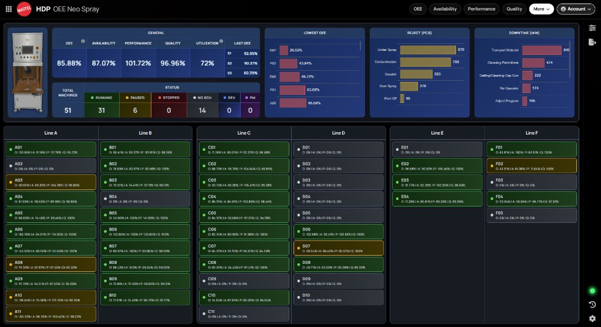

# HDP OEE Neo Spray — Overview

**HDP OEE Neo Spray** is a real-time and historical manufacturing **Overall Equipment Effectiveness (OEE)** monitoring module inside the **HDP Studio** suite (solution `LoginAndRegisterMVCMD5.sln`, repository `inside-mvc`). It provides live shopfloor visibility, shift KPI aggregation, pareto analytics, throw-off reject logging, Power BI report integration, and multi-format data export for **Neo Spray** lines (`fprocess_code = "C07"`, `fmachine_code = "C073"`).

> [!NOTE]
> All module identifiers, controller actions, Razor views, Entity Framework contexts, and database objects documented here are verified directly against `inside-mvc`. Credentials, connection strings, personal email addresses, and internal Power BI URLs are intentionally excluded.

---

## Purpose & Operational Scope

HDP OEE Neo Spray serves two primary operational use cases:

1. **Shopfloor Live Monitoring (Andon / TV & Supervisor View):** Continuously tracks machine running states across 6 spray lines (`A`–`F`), live shift OEE metrics (`OEE`, `Availability`, `Performance`, `Quality`, `Utilization`), previous shift OEE benchmarks (`S1`, `S2`, `S3`), and pareto charts for **Lowest OEE**, **Reject (pcs)**, and **Downtime (min)**.
2. **Historical Analysis & Data Operations:** Supports multi-dimensional filtering (`Year`, `Month`, `Week Ending`, `Date`, `Shift`, `Machine`), switching between **Simple** and **Aggregate** OEE calculation modes, logging throw-off rejects per machine/shift/toy, resetting active shift machine state (`EndShift`), and exporting filtered records to **CSV**, **Excel (`.xlsx`)**, or **PDF**.

---

## Entry Points & HDP Studio Integration

HDP OEE Neo Spray is accessible across three navigation surfaces inside `inside-mvc`:

| Entry Point | Source File | Label / Presentation | Target Route |
| :--- | :--- | :--- | :--- |
| **HDP Studio Hub** | `Views/HDPStudio/Index.cshtml` | Card **#1 — OEE Neo Spray** (category `Neo Spray`, banner `#D97757`, searchable via `oee neo spray layout live throw-off reject availability performance quality`) | `~/OEE/NeoSprayLayout` *(new tab)* |
| **HDP Studio App Launcher** | `Views/Shared/_Layout_HDPStudio.cshtml` | **OEE Neo Spray** tile | `~/OEE/NeoSprayLayout` *(new tab)* |
| **Legacy INSIDE Sidebar** | `Views/Shared/Sidebar/_Decoration.cshtml` | **OEE Neo Spray** (`fa-spray-can`) | `~/OEE/NeoSprayLayout` *(new tab)* |

> [!TIP]
> **New vs. Legacy App Tiles:** Both the HDP Studio Hub (`~/OEE/HDPOEEStudio`, banner `#EBC9B7`) and the App Launcher (`~/OEE/SemiAutoSprayLayout`) also display an adjacent **OEE Neo Spray (OLD)** tile for legacy Semi-Auto Spray archival reference. Always choose **OEE Neo Spray** for the active `C073` dashboard.

---

## Technology Stack

| Layer | Technology / Component | Usage in HDP OEE Neo Spray |
| :--- | :--- | :--- |
| **Runtime & Web Framework** | ASP.NET MVC 5 · .NET Framework 4.7.2 | Routing, Razor view rendering, JSON API actions (`OEEController.cs`) |
| **ORM & Persistence** | Entity Framework 6 (Database-First EDMX) · SQL Server | Dual `DbContext` access (`HDPStudioEntities` & `HDPStudioOEEStudioEntities`) |
| **Layout Shell** | Razor `_Layout_HDPStudio.cshtml` | Top navigation bar, HDP Studio app launcher, right sidebar (`Filter`, `Changelog`, `Settings`) |
| **UI & Charts** | Bootstrap 5 · jQuery · Chart.js · FontAwesome 6 | Floor grid cards, dynamic tooltips, scrollable horizontal bar charts with pinned X-axes |
| **Document Export** | ClosedXML · iTextSharp · UTF-8 CSV | Server-side generation of `.xlsx`, `.pdf`, and `.csv` downloads in `ExportNeoSpray` |
| **BI Integration** | Embedded Power BI `<iframe>` | Dynamically loaded via `hdps_pbi_link` table in `NeoSprayReport.cshtml` |

---

## Module Page Matrix

All Neo Spray routes live under `Controllers/OEEController.cs` and share `Views/Shared/_Layout_HDPStudio.cshtml`. The layout activates Neo Spray mode whenever `currentController == "OEE"` and `currentAction.StartsWith("NeoSpray")` (`isNeoSpray == true`).

| Route (`OEEController`) | View (`Views/OEE/`) | Navigation Tab | Right Sidebar | Implementation Status |
| :--- | :--- | :--- | :--- | :--- |
| `/OEE/NeoSprayLayout` | `NeoSprayLayout.cshtml` | **More → Live Layout** *(Default landing)* | Enabled | **Active** — Live floor layout, KPI table, status counts, 3 Chart.js pareto charts |
| `/OEE/NeoSprayInputReject` | `NeoSprayInputReject.cshtml` | **More → Input Reject (Throw-off)** | Disabled | **Active** — Cascading machine/date/shift/toy reject entry form |
| `/OEE/NeoSprayReport` | `NeoSprayReport.cshtml` | **More → Report (Power BI)** | Disabled | **Active** — Dynamic Power BI embed from `hdps_pbi_link` |
| `/OEE/NeoSprayOEE` | `NeoSprayOEE.cshtml` | **OEE** | Enabled | *Under Development* (placeholder) |
| `/OEE/NeoSprayAvailability` | `NeoSprayAvailability.cshtml` | **Availability** | Enabled | *Under Development* (placeholder) |
| `/OEE/NeoSprayPerformance` | `NeoSprayPerformance.cshtml` | **Performance** | Enabled | *Under Development* (placeholder) |
| `/OEE/NeoSprayQuality` | `NeoSprayQuality.cshtml` | **Quality** | Enabled | *Under Development* (placeholder) |
| `/OEE/NeoSprayMore` | `NeoSprayMore.cshtml` | **More → Live Preview** *(commented out)* | Enabled | *Under Development* (placeholder) |

> [!IMPORTANT]
> **Shopfloor Authentication Exemption:** In `_Layout_HDPStudio.cshtml`, routes matching `isNeoSpray` bypass the standard INSIDE session login wall (`Session["us_usrname"] != null || ... || isNeoSpray`). This allows dedicated shopfloor monitors and TVs to keep `NeoSprayLayout` running continuously without manual sign-in.

---

## Shopfloor Topology & Machine States

`NeoSprayLayout.cshtml` models **51 configured machines** grouped across **6 production lines** (`lineConfig`):

| Line | Machine Count | Display Codes | Numeric Range (`fmachine_no`) |
| :--- | :---: | :--- | :---: |
| **Line A** | 11 | `A01` – `A11` | `1` – `11` |
| **Line B** | 10 | `B01` – `B10` | `12` – `21` |
| **Line C** | 11 | `C01` – `C11` | `22` – `32` |
| **Line D** | 10 | `D01` – `D10` | `33` – `42` |
| **Line E** | 4 | `E01` – `E04` | `43` – `46` |
| **Line F** | 5 | `F01` – `F05` | `47` – `51` |
| **Total** | **51** | `A01` – `F05` | `1` – `51` *(50 production + 1 dev baseline)* |

### Real-Time Machine Status Decoding

Each machine card polls live state from `hdps_oee_cur_condition` via `GetSemiAutoSprayMachines` and maps `(machineStatus, pcServerState)` using `getStatus()`:

| `pcServerState` | `machineStatus` | Display Label | CSS Class | Indicator Color | Meaning |
| :---: | :---: | :--- | :--- | :---: | :--- |
| `!= 0` | *Any* | **NO SCH** | `status-disconnected` | `#c9d1d9` | PC/server disconnected or no active schedule |
| `0` | `1` | **STOPPED** | `status-stopped` | `#f85149` | Machine stopped / breakdown |
| `0` | `2` | **PAUSED** | `status-idle` | `#eab308` | Machine paused / idle |
| `0` | `3` | **RUNNING** | `status-running` | `#56d364` | Active production running |
| `0` | `4` | **DEV** | `status-dev` | `#3b82f6` | Development / engineering trial |
| `0` | `5` | **PM** | `status-pm` | `#a371f7` | Preventive maintenance in progress |
| `0` | *Other* | **NO SCH** | `status-disconnected` | `#c9d1d9` | Unscheduled / unmapped state |

Hovering over any machine card opens a rich Bootstrap 5 HTML tooltip displaying live **OEE**, **Availability**, **Performance**, **Quality**, **Target Output**, **Actual Output**, **Good Output**, and **Reject Output** (auto-dismissed after 30 seconds).

---

## Key Features at a Glance

- **Live Dual-Rate Polling:** `NeoSprayLayout.cshtml` refreshes machine floor status every **3 seconds** and refreshes KPI metrics plus all 3 Chart.js charts every **30 seconds**.
- **Shared Right-Sidebar Workspace (`isNeoSpraySidebar`):**
  - **Filter (`#rs-filter`):** Cascading multi-select filters (`Year`, `Month`, `Week Ending`, `Date`, `Shift`, `Machine`) backed by `GetNeoSprayFilterOptions`.
  - **Settings (`#rs-settings`):** Persistent **Simple vs. Aggregate** OEE calculation mode toggle (`hdps_common_mst_setting`) and **Reset active machines** (`EndShift`) control.
  - **Export (`rsDownloadData`):** Exports filtered Neo Spray OEE rows in **CSV**, **Excel (`.xlsx`)**, or **PDF** format.
  - **Changelog (`#rs-changelog`):** Tracks module release milestones (*First release — Jan 2, 2026*; *Second release — Apr 20, 2026*; *Third release — Aug 12, 2026*).
- **Throw-Off Reject Entry (`NeoSprayInputReject`):** Allows operators/leaders to record additional reject quantities against a specific machine, date, shift, and toy/part, automatically recalculating `Good_Output`, `Var`, `Quality`, and `OEE` on `AS_OEE` and appending an audit row in `AS_Reject`.

---

## Documentation Map

| Chapter | What It Covers |
| :--- | :--- |
| 1. **Overview** *(this page)* | Module scope, technology stack, page matrix, 51-machine topology, and status codes |
| 2. [System Architecture](./system-architecture.md) | Component diagrams, dual-`DbContext` layer, frontend event bus, sequence & ER diagrams |
| 3. [Pages, UI & Right Sidebar](./pages-and-ui.md) | `_Layout_HDPStudio` shell, 5-panel sidebar, cascading filters, charts, Input Reject & Power BI views |
| 4. [OEE Formulas & Business Logic](./oee-formulas-and-logic.md) | Simple vs. Aggregate OEE modes, dynamic shifts, Live vs. Historical rules, Last OEE `S1`–`S3` |
| 5. [API & Data Export Reference](./api-and-exports.md) | All `OEEController` JSON/POST endpoints, payloads, and CSV/XLSX/PDF export contracts |
| 6. [Database Schema & Views](./database-schema.md) | Full column definitions across `HDPStudioEntities` and `HDPStudioOEEStudioEntities` |
| 7. [Operator & Supervisor Guide](./user-guide.md) | Daily floor monitoring, filtering, exports, throw-off reject input, shift reset & troubleshooting |
