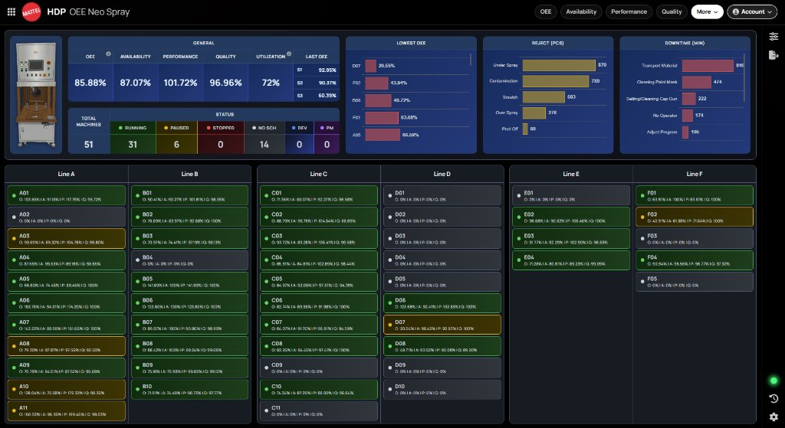

# Pages, UI & Right Sidebar

This chapter documents every Razor view, shared layout component, interactive widget, chart plugin, and client-side behavior in **HDP OEE Neo Spray** (`Views/Shared/_Layout_HDPStudio.cshtml` and `Views/OEE/NeoSpray*.cshtml`).

---

## 1. Shared Layout Shell (`_Layout_HDPStudio.cshtml`)

All Neo Spray pages inherit `~/Views/Shared/_Layout_HDPStudio.cshtml`. The layout inspects route metadata at render time to configure branding, breakpoints, authentication rules, and the right sidebar:

```csharp
var currentController = ViewContext.RouteData.Values["controller"]?.ToString() ?? "";
var currentAction     = ViewContext.RouteData.Values["action"]?.ToString() ?? "";

bool isNeoSpray = currentController == "OEE" && currentAction.StartsWith("NeoSpray");
bool isNeoSpraySidebar = currentController == "OEE" && (
    currentAction == "NeoSprayOEE" ||
    currentAction == "NeoSprayAvailability" ||
    currentAction == "NeoSprayPerformance" ||
    currentAction == "NeoSprayQuality" ||
    currentAction == "NeoSprayMore" ||
    currentAction == "NeoSprayLayout"
);
```

### Header & Navigation Structure

| Element | Behavior on `isNeoSpray` Routes |
| :--- | :--- |
| **App Launcher (9-dot menu)** | Opens the HDP Studio app switcher modal containing links to *OEE Neo Spray* (`~/OEE/NeoSprayLayout`), *OEE Neo Spray (OLD)* (`~/OEE/SemiAutoSprayLayout`), *Locator Nest DIJ*, *Piloting Report DIJ*, *Counting Downtime DIJ*, *Sample Tracking*, *Preventive Maintenance*, and *INSIDE*. |
| **Brand Title & Link** | Displays `HDP OEE Neo Spray` and navigates back to `Url.Action("NeoSprayLayout", "OEE")`. |
| **Primary Tabs** | `OEE`, `Availability`, `Performance`, `Quality` — highlighted via `ViewBag.ActiveTab`. |
| **More Dropdown** | Contains **Live Layout** (`NeoSprayLayout`), **Report (Power BI)** (`NeoSprayReport`), and **Input Reject (Throw-off)** (`NeoSprayInputReject`). *Live Preview* (`NeoSprayMore`) is currently commented out in markup. |
| **Account Menu** | Shows `Profile` / `Log Out` when `Session["us_usrname"] != null`, or `Log In` / `Register` modals otherwise. |
| **Mobile Breakpoint** | Switches top pill tabs into a full-height `.mobile-menu-overlay` drawer at **`<= 880px`** viewport width (`mobileBreakpoint = 880`). |
| **Footer** | Hidden when `currentController == "OEE"` to maximize vertical space on shopfloor dashboards. |

---

## 2. Right Sidebar Workspace (`isNeoSpraySidebar`)

When `isNeoSpraySidebar == true`, the `<body>` receives class `has-rs-strip`, docking a vertical icon strip (`#rsSidebarStrip`) on the right edge — split into a **top group** (`Filter`, `Export`) and a **bottom group** (`Live`, `Changelog`, `Settings`) — plus a slide-out drawer (`#rsSidebarPanel`) with **five panels**:

| Strip Button ID | Panel Section ID | Strip Position | Icon | Purpose |
| :--- | :--- | :---: | :--- | :--- |
| `#rsBtn-filter` | `#rs-filter` | Top | `fa-sliders` | Multi-dimensional historical filter with active indicator dot (`#rsFilterDot`). |
| `#rsBtn-convert` | `#rs-convert` | Top | `fa-file-export` | Download currently filtered OEE dataset as `CSV`, `Excel (.xlsx)`, or `PDF`. |
| `#rsBtn-live` | `#rs-live` | Bottom | Pulsing green dot | Live radar clock panel (`#rsLiveStatus`) ticking `Last scan HH:mm:ss` every second locally via `rsTickRadar()` *(client-side clock — does not query backend health)*. |
| `#rsBtn-changelog` | `#rs-changelog` | Bottom | `fa-clock-rotate-left` | Release history timeline (*Jan 2, 2026*; *Apr 20, 2026*; *Aug 12, 2026*). |
| `#rsBtn-settings` | `#rs-settings` | Bottom | `fa-gear` | **Reset active machines** (`EndShift`) and **Simple / Aggregate** OEE mode toggle. |

Pressing `Escape` or clicking the close button (`×`) collapses `#rsSidebarPanel`.

### Cascading Multi-Select Filter Mechanics (`#rs-filter`)

On page load, `initNeoSprayFilter()` calls `GET /OEE/GetNeoSprayFilterOptions` and populates six custom checkbox dropdowns:

1. **Year** (`#rsFilterYear`) — Descending years (e.g., `2026`, `2025`).
2. **Month** (`#rsFilterMonth`) — Stores compound `yyyy-M` checkbox values (e.g., `2026-4`), displayed as `April 2026`. When applying filters, `applyNeoSprayFilter()` extracts the plain month number for backend query parameters while keeping `_monthYM` for active-filter counting.
3. **Week Ending** (`#rsFilterWE`) — Formatted as `MM/DD/YYYY`.
4. **Date** (`#rsFilterDate`) — Formatted as `MM/DD/YYYY`.
5. **Shift** (`#rsFilterShift`) — Displayed as `Shift 1`, `Shift 2`, `Shift 3`.
6. **Machine** (`#rsFilterMachine`) — Numeric machine IDs formatted into line codes.

#### Selection & Cascading Rules

- **Default State:** Each unselected dropdown displays **`Live`** (indicating real-time current-shift mode).
- **Single-Click vs. Multi-Select:**
  - **Left-click** an option: selects *only* that item (or deselects it if it was the sole selected item).
  - **`Ctrl + Left-click` (or `Cmd + Click`)**: toggles an item while keeping existing selections checked.
  - **Select All**: checks or unchecks all *currently visible* options in that dropdown (tracks indeterminate checkbox state).
- **4-Way Hierarchical Date Cascade (`syncCascadeOptions()`):**
  - `_allFilterRows` stores distinct `{ year, month, date, we }` tuples returned by `GetNeoSprayFilterOptions`.
  - Selecting any value in `Year`, `Month`, `Week Ending`, or `Date` dynamically hides non-matching options in the other three date fields and unchecks any hidden selections to prevent impossible filter combinations.
- **Instant Apply:** Every checkbox change or individual field clear (`×`) immediately invokes `applyNeoSprayFilter()`, updates `#rsFilterActiveBadge` (`N filter(s) active`) and `#rsFilterDot`, and dispatches `CustomEvent('neoSprayFilterApplied', { detail: f })` on `document`.
- **Clear All:** Clicking **Clear all filters** resets all six dropdowns to `Live`, restores all cascaded options, hides the footer/dot, and dispatches `CustomEvent('neoSprayFilterCleared')`.

> [!WARNING]
> **Known Machine-Label Range Discrepancy (`#rsFilterMachine` & `NeoSprayInputReject`):** Both `#rsFilterMachine` in `_Layout_HDPStudio.cshtml` and `FormatMachineName(int n)` in `NeoSprayInputReject.cshtml` map numeric IDs `43–53` to Line `E` (`E01`–`E11`) and `54–63` to Line `F` (`F01`–`F10`), whereas `NeoSprayLayout.cshtml` (`lineConfig`) and `OEEController.GetMachineDisplayCode()` map `43–46` to Line `E` (`E01`–`E04`) and `47–51` to Line `F` (`F01`–`F05`). As a result, Line `F` machines (`47–51`) appear as `E05`–`E09` in both the right-sidebar Machine filter and the Input Reject Machine dropdown.

### Settings & Export Controls (`#rs-settings`, `#rs-convert`)

- **Export (`rsDownloadData(format)`):** Disables export buttons while fetching `GET /OEE/ExportNeoSpray?format={csv|xlsx|pdf}&...`, creates a temporary blob URL, triggers browser download (`NeoSpray_Export.{ext}`), and updates `#rsConvertStatus` (`Preparing...` → `Download ready.`).
- **Reset Active Machines (`executeResetActiveMachine()`):** Shows a browser confirmation dialog before sending `POST /OEE/EndShift`, then reloads the page on success.
- **OEE Calculation Mode (`setCalculationMode(mode)`):**
  - On load, queries `GET /OEE/GetOEECalculationMode?_t={timestamp}` (`cache: 'no-store'`) and falls back to `localStorage['hdp_calculation_mode']` if unavailable.
  - On click, prompts for confirmation, persists to `localStorage`, dispatches `window` event `hdpCalculationModeChanged`, submits `POST /OEE/UpdateOEECalculationMode` with `__RequestVerificationToken`, and reloads the page so all panels recalculate consistently.

---

## 3. Live Layout Dashboard (`NeoSprayLayout.cshtml`)

`NeoSprayLayout.cshtml` (1,671 lines) is the default landing page for **HDP OEE Neo Spray**. It is structured into two vertical zones: the **Layout Header** (machine photo, KPI tables, and three pareto charts) and the **Lines Grid** (51 real-time machine cards).



### Zone A: Machine Photo Lightbox & Summary Tables

1. **Waterbase Machine Reference Photo:** Displays `~/Asset/HDPStudio/waterbase-machine.png` with `cursor: zoom-in`. Clicking opens `#imageLightbox` (dismissible via `×`, clicking backdrop/image, or `Esc`).
2. **General KPI Table:**
   - Columns: **OEE** *(with formula tooltip)*, **Availability**, **Performance**, **Quality**, **Utilization** *(with formula tooltip)*, and **Last OEE** (stacked `S1`, `S2`, `S3` badges).
   - Displays `#generalSpinner` overlay during filter-triggered reloads (background 30s polls refresh silently).
   - Recomputes displayed `OEE` on the client as `Math.round((availability / 100) * (performance / 100) * (quality / 100) * 10000) / 100 + '%'` to stay visually consistent with `A × P × Q`.
3. **Machine Status Table:**
   - Displays **Total Machines** (`51`) and live counts for **Running**, **Paused**, **Stopped**, **No Sch**, **Dev**, and **PM**, recalculated on every 3-second status poll.

### Zone B: Scrollable Horizontal Pareto Charts (Chart.js)

Three side-by-side chart cards sit inside `.chart-tables-container`:

| Chart Card | Endpoint | Bar Fill / Border Color | Unit | Empty State Axis |
| :--- | :--- | :--- | :---: | :---: |
| **Lowest OEE** | `GetNeoSprayLowestOEE` | Red `rgba(248, 81, 73, 0.5)` / `#f85149` | `%` | `0 – 100` |
| **Reject (pcs)** | `GetNeoSprayReject` | Amber `rgba(234, 179, 8, 0.5)` / `#eab308` | *(none)* | `0 – 10` |
| **Downtime (min)** | `GetNeoSprayDowntime` | Red `rgba(248, 81, 73, 0.5)` / `#f85149` | *(none)* | `0 – 10` |

Key visual engineering details:
- **Custom `barValuePlugin`:** Hooks `afterDatasetsDraw` to paint bold `#c9d1d9` numeric labels (dot-separated thousands, e.g., `1.250` or `78.4%`) at `bar.x + 6, bar.y`. Each X-axis uses `suggestedMax: Math.max(...data) * 1.12` to leave 12% right-side margin for labels.
- **Scrollable Bar Area + Pinned X-Axis:** Each chart displays up to `MAX_VISIBLE = 5` bars inside a `200px` (`~40px` per bar) vertically scrollable container. When more than 5 categories exist, the bar canvas expands vertically (`labels.length * 40px`) while a separate `40px`-tall X-axis canvas (`*ChartXAxis`) remains pinned underneath.
- **Responsive Resize (`ResizeObserver`):** Observes all three scroll containers with a `150ms` debounce and redraws cached chart datasets cleanly whenever viewport dimensions change.
- **Empty State:** When an endpoint returns zero rows, each chart renders a gray (`rgba(72, 79, 88, 0.5)`) placeholder bar labeled `No Data`.

### Zone C: 51-Machine Shopfloor Lines Grid (`#linesGrid`)

- `renderLayout()` groups the 6 configured lines into **3 side-by-side pairs** (`Line A + Line B`, `Line C + Line D`, `Line E + Line F`).
- Shorter lines (`B: 10`, `D: 10`, `E: 4`, `F: 5`) are padded with `visibility: hidden` placeholder cards up to `maxMachines` (`11`) so rows align across all line columns.
- `updateMachineStatus(machines)` strips the `"SAS "` prefix from `machineCode` to match `[data-machine="{code}"]`, updates status classes, and computes `disconnected = totalConfigured - (running + stopped + idle + dev + pm)`.
- **Card Inline Text vs. Tooltip Precision:**
  - Card body displays **truncated** (floored to 2 decimals) values: `O: xx% | A: xx% | P: xx% | Q: xx%`.
  - Hovering reveals a Bootstrap 5 HTML tooltip showing status color header, **rounded** `toFixed(2)` OEE / A / P / Q percentages, plus `Target Output`, `Actual Output`, `Good Output`, and `Reject Output` (pcs). Tooltips automatically hide after **30 seconds**.

### Polling & Event Subscriptions

| Trigger | Actions Executed | Shows Spinner? |
| :--- | :--- | :---: |
| Initial `$(document).ready()` | `renderLayout()`, `loadMachineStatus()`, `loadOEEMetrics(false)`, all 3 chart loaders `(false)` | No |
| Every **3,000 ms** (`setInterval`) | `loadMachineStatus()` | No |
| Every **30,000 ms** (`setInterval`) | `loadOEEMetrics(false)`, `loadDowntimeChart(false)`, `loadRejectChart(false)`, `loadLowestOeeChart(false)` | No |
| `neoSprayFilterApplied` / `neoSprayFilterCleared` | `loadOEEMetrics(true)` and all 3 chart loaders `(true)` | Yes |
| `hdpCalculationModeChanged` | `loadOEEMetrics(false)` | No |

---

## 4. Input Reject / Throw-Off (`NeoSprayInputReject.cshtml`)

`NeoSprayInputReject.cshtml` (772 lines) provides a dedicated full-page form (right sidebar disabled) for recording throw-off reject quantities against historical or current shift runs.

### Form Fields & Cascading State Machine

| Step | Field (`id`) | Source & Behavior |
| :---: | :--- | :--- |
| **1** | **Machine** (`#machine`) | Server-rendered from `ViewBag.Machines` (distinct `AS_OEE.Machine` formatted via `FormatMachineName(m)`; falls back to `A01`, `A02`, `A03` if empty). Changing resets Date, Shift, Toy, and outputs. |
| **2** | **Date** (`#date`) | Initially disabled. First checks preloaded `machineDatesMap[machine]` (`ViewBag.MachineDatesJson`) for instant rendering; falls back to `GET /OEE/GetDatesByMachine`. |
| **3** | **Shift** (`#shift`) | Initially disabled. Loaded via `GET /OEE/GetShiftsByMachineAndDate` after a Date is chosen. |
| **4** | **Toy (part number - description)** (`#toy`) | Loaded via `GET /OEE/GetToysByShift`. **Auto-selects** automatically when only 1 toy exists for that shift, immediately filling read-only summary fields. |
| **5** | **Reject quantity** (`#inputReject`) | Positive integer input (`min="0"`, `step="1"`) equipped with custom up/down stepper buttons (`stepValue('inputReject', ±1)` clamped at `>= 0`). |
| **6** | **Reject name** (`#rejectName`) | Populated from `ViewBag.RejectNames` (`Code_Reject` filtered by `Process_Code == "C07"` or blank, falling back to all `Code_Reject` names). |
| **Read-only** | **Last actual output** (`#actualOutput`) & **Last reject** (`#lastReject`) | Auto-populated from the selected `<option>`'s `data-actual` and `data-reject` attributes to give operators immediate context before submitting. |

### Submission & Feedback Behavior

- `submitProductionInput(e)` validates a Toy is selected, disables `#btnSave`, and posts `{ oeeId, machine, date, shift, rejectName, inputReject }` to `POST /OEE/SaveNeoSprayInputReject`.
- On success, displays a 4-second green toast alert (`#toastAlert.toast-alert-success`) and calls `onShiftChange()` to reload the shift's toys so `Last reject quantity` immediately reflects the new total.
- **Reset** button (`handleResetForm()`) resets the form, disables dependent dropdowns, and hides any active toast.
- **Back to dashboard** button links directly to `Url.Action("NeoSprayLayout", "OEE")`.

---

## 5. Power BI Report (`NeoSprayReport.cshtml`)

`NeoSprayReport.cshtml` (81 lines) renders a full-viewport (`calc(100vh - 60px)`) Power BI container without the right sidebar:

- **Configured State (`ViewBag.PbiLink` non-empty):** Renders a rounded `.report-card` containing a full-size `<iframe src="@ViewBag.PbiLink" allowfullscreen></iframe>` plus a floating top-right external launch button (`.report-open-btn`, `target="_blank" rel="noopener noreferrer"`).
- **Unconfigured State:** Displays a centered muted message: `"No report link configured."`

---

## 6. Under-Development Pages

Five Neo Spray Razor views (`73` lines each) currently render a standardized `"Under Development"` card under `_Layout_HDPStudio.cshtml` with `isNeoSpraySidebar = true`, ready to subscribe to the existing filter and calculation-mode events once implemented:

| View | `ViewBag.ActiveTab` | Planned Focus |
| :--- | :--- | :--- |
| `NeoSprayOEE.cshtml` | `"oee"` | Dedicated OEE trend & drill-down analytics |
| `NeoSprayAvailability.cshtml` | `"availability"` | Availability & downtime breakdown analytics |
| `NeoSprayPerformance.cshtml` | `"performance"` | Performance, cycle-time & output variance analytics |
| `NeoSprayQuality.cshtml` | `"quality"` | Quality yield & reject pareto analytics |
| `NeoSprayMore.cshtml` | `"live-preview"` | Alternative live preview layout *(currently commented out in navigation)* |

---

## Next Step

Continue to [OEE Formulas & Business Logic](./oee-formulas-and-logic.md) for the exact server-side and client-side math behind Simple OEE, Aggregate OEE, Shift resolution, Last OEE lookback, and Reject recalculation.
