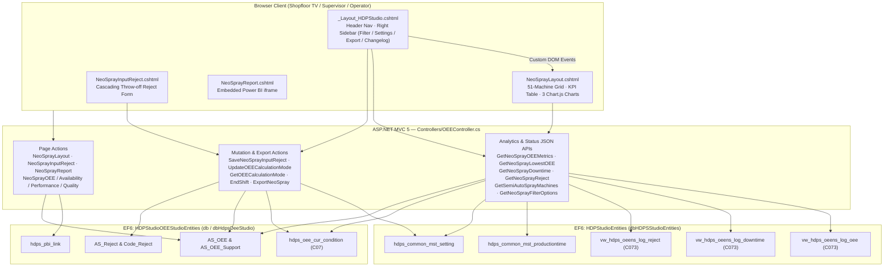
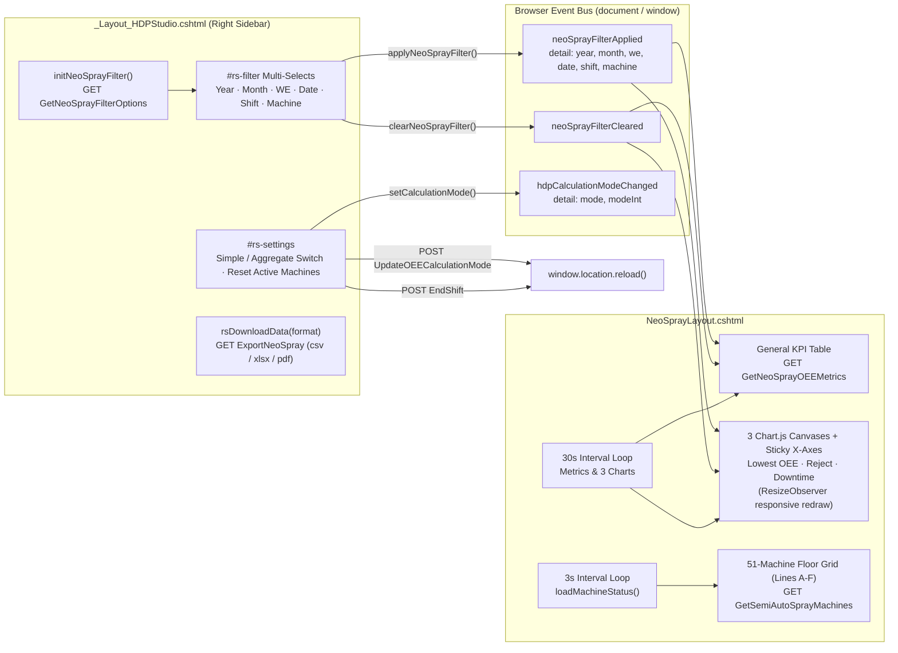
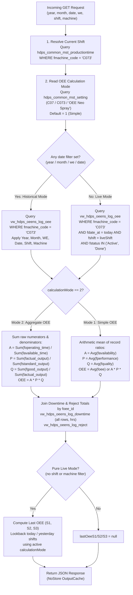
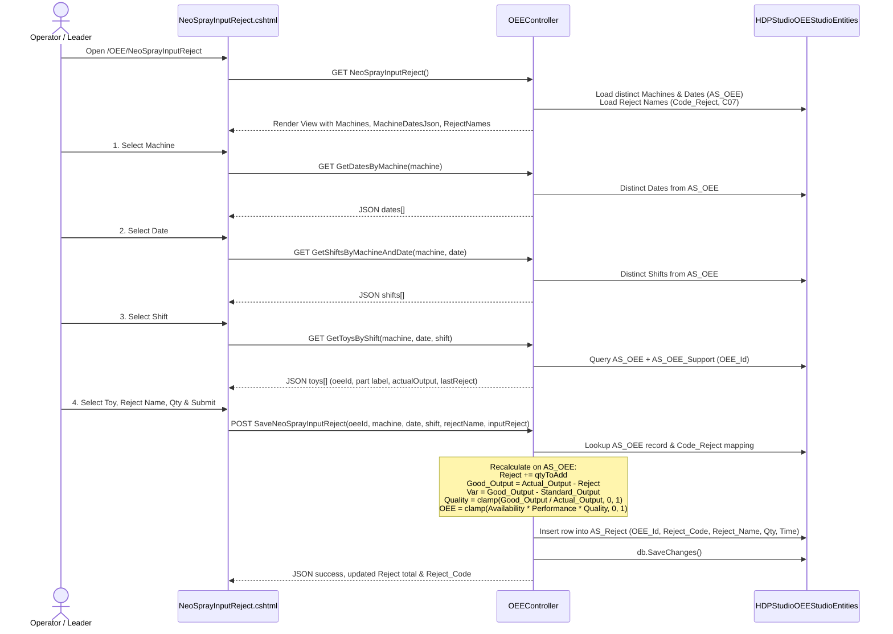
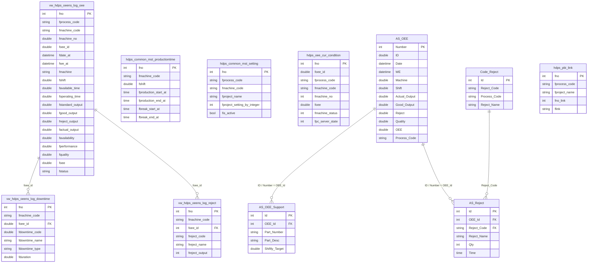

# HDP OEE Neo Spray — System Architecture

This document details the end-to-end technical architecture of **HDP OEE Neo Spray** inside `inside-mvc` (`LoginAndRegisterMVCMD5.sln`), covering its layered MVC design, dual Entity Framework `DbContext` persistence boundaries, layout-to-view custom event bus, live vs. historical OEE calculation pipeline, reject input transaction flow, and database relationships.

---

## 1. High-Level Component Architecture

HDP OEE Neo Spray follows a **Server-Rendered Razor Shell + AJAX/JSON Polling** architecture on ASP.NET MVC 5 (.NET Framework 4.7.2). A notable architectural characteristic is its **Dual `DbContext` Persistence Layer**, bridging newer HDP Studio analytical SQL views (`HDPStudioEntities`) with operational OEE Studio tables (`HDPStudioOEEStudioEntities`).

### Architectural Layer Responsibilities

| Layer | Key Artifacts | Responsibility |
| :--- | :--- | :--- |
| **Shared Shell** | `Views/Shared/_Layout_HDPStudio.cshtml` | Detects `isNeoSpray` / `isNeoSpraySidebar`, bypasses auth wall for shopfloor monitors, owns right-sidebar filter state, calculation mode switcher, End-Shift trigger, and file export downloads. |
| **Feature Views** | `Views/OEE/NeoSprayLayout.cshtml`, `NeoSprayInputReject.cshtml`, `NeoSprayReport.cshtml` | Renders shopfloor machine grid, KPI summary, scrollable horizontal Chart.js pareto charts, cascading reject entry form, and Power BI report frame. |
| **Controller** | `Controllers/OEEController.cs` | Serves Razor views, computes Live/Historical OEE metrics (Simple & Aggregate), resolves shift windows dynamically, recalculates reject impact, and streams CSV/XLSX/PDF exports. |
| **Analytics Data Layer** | `HDPStudioEntities` (`Models/HDPStudio.Context.cs`) | Provides read access to Neo Spray SQL views (`vw_hdps_oeens_log_*`) scoped to `fmachine_code = "C073"` plus master shift times and calculation mode settings. |
| **Operational Data Layer** | `HDPStudioOEEStudioEntities` (`Models/HDPStudioOEEStudio.Context.cs`) | Provides live floor state (`hdps_oee_cur_condition`), filter/export source (`AS_OEE`), reject writes (`AS_OEE`, `AS_Reject`, `Code_Reject`), and Power BI embed URLs (`hdps_pbi_link`). |

---

## 2. Frontend Layout, Polling & Custom Event Bus

Rather than coupling sidebar filter widgets directly to page-specific chart functions, `_Layout_HDPStudio.cshtml` acts as an **event emitter** and `NeoSprayLayout.cshtml` acts as a **reactive subscriber**. This allows future Neo Spray tabs (`NeoSprayOEE`, `NeoSprayAvailability`, `NeoSprayPerformance`, `NeoSprayQuality`) to reuse the same filter sidebar without modifying the layout script.

### Chart Rendering Pattern in `NeoSprayLayout.cshtml`

Each pareto chart (**Lowest OEE**, **Reject (pcs)**, **Downtime (min)**) uses a **dual-canvas architecture** to keep the horizontal axis visible when many machines or defect categories are present:
1. **Scrollable Bar Canvas** (`#lowestOeeChart`, `#rejectChart`, `#downtimeChart`) inside a `max-height: 212px; overflow-y: auto;` wrapper whose height grows dynamically based on bar count (`labels.length * PER_BAR`).
2. **Pinned X-Axis Canvas** (`#lowestOeeChartXAxis`, `#rejectChartXAxis`, `#downtimeChartXAxis`) anchored directly below the scroll container (`height: 40px`) synchronized to the same scale.
3. **`ResizeObserver`** monitors all three scroll containers and cleanly destroys/recreates Chart.js instances on viewport resize.

---

## 3. Live vs. Historical Query & OEE Calculation Pipeline

All four Neo Spray analytics endpoints (`GetNeoSprayOEEMetrics`, `GetNeoSprayLowestOEE`, `GetNeoSprayDowntime`, `GetNeoSprayReject`) follow a consistent server-side decision pipeline.

### Calculation Mode Comparison

| Mode | `fproject_setting_by_integer` | Formula Basis | Best Used When |
| :--- | :---: | :--- | :--- |
| **Simple OEE** | `1` *(default)* | Unweighted average of individual record percentages (`favailability`, `fperformance`, `fquality`, `foee`) | Comparing equal-weight per-run / per-machine percentages |
| **Aggregate OEE** | `2` | Weighted ratio of summed totals: `Sum(Operating) / Sum(Available)` × `Sum(Actual) / Sum(Standard)` × `Sum(Good) / Sum(Actual)` | Evaluating true plant/line throughput weighted by operating time and volume |

### Additional Pipeline Rules

- **Dynamic Shift Resolution:** Instead of hardcoding shift start hours (as legacy Semi-Auto Spray endpoints do), Neo Spray reads `fproduction_start_at` for shifts `1`, `2`, and `3` from `hdps_common_mst_productiontime` (`fmachine_code == "C073"`).
- **Downtime Filtering:** `GetNeoSprayDowntime` excludes scheduled breaks (`fdowntime_name != "Break"` and `"BREAK"`), converts `fduration` from hours to minutes (`* 60`), and sorts descending.
- **Utilization Baseline:** Distinct active machines divided by selected machine count (or default baseline of `50` production machines = `51 total - 1 dev`), capped at `100%`.
- **Lowest OEE Live Tie-Breaker:** In unfiltered live mode, `GetNeoSprayLowestOEE` selects each machine's latest session (`max(foee_id)`), picks the top record by `(foee, fno)`, and sorts ascending so the lowest-performing machines appear first.
- **Last OEE (`S1`, `S2`, `S3`) Lookback Window:** Computed only in pure live mode:
  - During **Shift 1:** `S1`, `S2`, `S3` reference `today - 1`.
  - During **Shift 2:** `S1` references `today`; `S2` and `S3` reference `today - 1`.
  - During **Shift 3:** `S1` and `S2` reference `today`; `S3` references `today - 1`.

---

## 4. Input Reject (Throw-Off) Transaction Flow

`NeoSprayInputReject.cshtml` implements a 4-step cascading selection workflow before committing a reject quantity against `HDPStudioOEEStudioEntities` (`AS_OEE` and `AS_Reject`).

---

## 5. Data Model & Entity Relationships

Because HDP OEE Neo Spray spans two Entity Framework `DbContext` models, entities relate logically via `foee_id` / `OEE_Id`, `fprocess_code = "C07"`, `fmachine_code = "C073"`, and `Reject_Code`.

---

## 6. Endpoint & Data-Source Map

| Endpoint (`OEEController`) | HTTP | DbContext | Database Objects | Purpose |
| :--- | :---: | :--- | :--- | :--- |
| `NeoSprayLayout` | `GET` | — | — | Renders main Live Layout dashboard (`ActiveTab = "live-layout"`). |
| `NeoSprayReport` | `GET` | `HDPStudioOEEStudioEntities` | `hdps_pbi_link` | Looks up Power BI link (`C07`, `"OEE Neo Spray"`, `fno_link = 1`) for iframe embed. |
| `NeoSprayInputReject` | `GET` | `HDPStudioOEEStudioEntities` | `AS_OEE`, `Code_Reject` | Renders cascading reject entry page with preloaded machine/date map and reject codes. |
| `GetSemiAutoSprayMachines` | `GET` | `HDPStudioOEEStudioEntities` | `hdps_oee_cur_condition` | Returns real-time machine status & live metrics (`fprocess_code = "C07"`) polled every 3s. |
| `GetNeoSprayOEEMetrics` | `GET` | `HDPStudioEntities` | `vw_hdps_oeens_log_oee`, `vw_hdps_oeens_log_downtime`, `vw_hdps_oeens_log_reject`, `hdps_common_mst_productiontime`, `hdps_common_mst_setting` | Computes Live/Historical OEE, A/P/Q, Utilization, Downtime, Reject totals, and Last OEE S1/S2/S3. |
| `GetNeoSprayLowestOEE` | `GET` | `HDPStudioEntities` | `vw_hdps_oeens_log_oee`, `hdps_common_mst_productiontime`, `hdps_common_mst_setting` | Returns machines ordered ascending by OEE for the Lowest OEE bar chart. |
| `GetNeoSprayDowntime` | `GET` | `HDPStudioEntities` | `vw_hdps_oeens_log_oee`, `vw_hdps_oeens_log_downtime`, `hdps_common_mst_productiontime` | Aggregates downtime duration in minutes by reason (excluding `Break` / `BREAK`). |
| `GetNeoSprayReject` | `GET` | `HDPStudioEntities` | `vw_hdps_oeens_log_oee`, `vw_hdps_oeens_log_reject`, `hdps_common_mst_productiontime` | Aggregates reject quantities by `freject_name`. |
| `GetNeoSprayFilterOptions` | `GET` | `HDPStudioOEEStudioEntities` | `AS_OEE` | Populates right-sidebar cascading filter options (`years`, `yearMonths`, `weekEndings`, `dates`, `rows`, `shifts`, `machines`). |
| `ExportNeoSpray` | `GET` | `HDPStudioOEEStudioEntities` | `AS_OEE` | Exports filtered OEE rows as `NeoSpray_Export.csv`, `.xlsx` (ClosedXML), or `.pdf` (iTextSharp). |
| `GetOEECalculationMode` | `GET` | `HDPStudioEntities` | `hdps_common_mst_setting` | Returns persisted calculation mode (`1` = Simple, `2` = Aggregate) with `NoStore` cache policy. |
| `UpdateOEECalculationMode` | `POST` | `HDPStudioEntities` | `hdps_common_mst_setting` | Updates or inserts calculation mode (`[ValidateAntiForgeryToken]` enforced). |
| `EndShift` | `POST` | `HDPStudioOEEStudioEntities` | `hdps_oee_cur_condition` | Resets active machine status & metric columns to `null` (single `GeneratedId` or all machines). |
| `GetDatesByMachine` / `GetShiftsByMachineAndDate` / `GetToysByShift` | `GET` | `HDPStudioOEEStudioEntities` | `AS_OEE`, `AS_OEE_Support` | Cascading lookup chain for `NeoSprayInputReject`. |
| `SaveNeoSprayInputReject` | `POST` | `HDPStudioOEEStudioEntities` | `AS_OEE`, `AS_Reject`, `Code_Reject` | Adds reject quantity, recalculates OEE metrics on `AS_OEE`, and inserts detail record into `AS_Reject`. |

---

## 7. Security & Operational Observations

> [!WARNING]
> **CSRF Protection Consistency:** `UpdateOEECalculationMode` properly enforces `[ValidateAntiForgeryToken]`, whereas `SaveNeoSprayInputReject` and `EndShift` are `[HttpPost]` endpoints currently lacking `[ValidateAntiForgeryToken]`. Adding anti-forgery token validation to those POST actions is recommended for future hardening in `inside-mvc`.

> [!NOTE]
> **Data-Source Split Awareness:** Live analytics charts read from `HDPStudioEntities` (`vw_hdps_oeens_log_*`, `fmachine_code = "C073"`), while sidebar filter options (`GetNeoSprayFilterOptions`), exports (`ExportNeoSpray`), and throw-off reject input (`SaveNeoSprayInputReject`) query/write `HDPStudioOEEStudioEntities` (`AS_OEE`, `fprocess_code = "C07"`). Keep both contexts synchronized when introducing schema changes or new Neo Spray dashboard tabs.

- **No Hardcoded External Links:** Power BI report URLs are stored in `hdps_pbi_link` and injected server-side via `ViewBag.PbiLink`, keeping deployment configuration out of source code.
- **Cache Control:** `GetNeoSprayOEEMetrics` and `GetOEECalculationMode` explicitly disable response caching (`[OutputCache(NoStore = true, Duration = 0, VaryByParam = "*")]`) to prevent stale KPI values on long-running shopfloor browsers.
- **Client Resilience:** Failed 3-second polling cycles in `loadMachineStatus()` fail silently so temporary network blips do not interrupt shopfloor TV displays.
- **Downtime Break Handling Difference:** `GetNeoSprayDowntime` (the **Downtime (min)** pareto chart) excludes `"Break"` / `"BREAK"` and converts `fduration` from hours to minutes (`* 60`), whereas `GetNeoSprayOEEMetrics.totalDowntimeDuration` sums raw `fduration` hours across all linked downtime rows without excluding breaks.
- **Unfiltered `AS_OEE` Lookups in Input Reject:** `NeoSprayInputReject()`, `GetDatesByMachine`, `GetShiftsByMachineAndDate`, and `GetToysByShift` query `AS_OEE` without filtering `Process_Code == "C07"` (unlike `GetNeoSprayFilterOptions` and `ExportNeoSpray`).
- **Strict Filter Parsing in `ExportNeoSpray`:** Query parameters (`year`, `month`, `we`, `date`, `shift`, `machine`) are parsed with `int.Parse` / `double.Parse` / `DateTime.Parse`, so malformed query strings return `HTTP 500` rather than `400 Bad Request`.
- **Legacy / Duplicate Controller Artifacts:** `GET /OEE/GetSemiAutoSprayStatus` exists in `OEEController.cs` as an unused lightweight sibling of `GetSemiAutoSprayMachines`, and `OEEController` instantiates two separate `HDPStudioOEEStudioEntities` fields (`db` and `dbHdpsOeeStudio`).

---

## Next Step

Continue to [Pages, UI & Right Sidebar](./pages-and-ui.md) for a detailed walkthrough of every view, the 5-panel right sidebar, Chart.js chart mechanics, and cascading filter controls.
